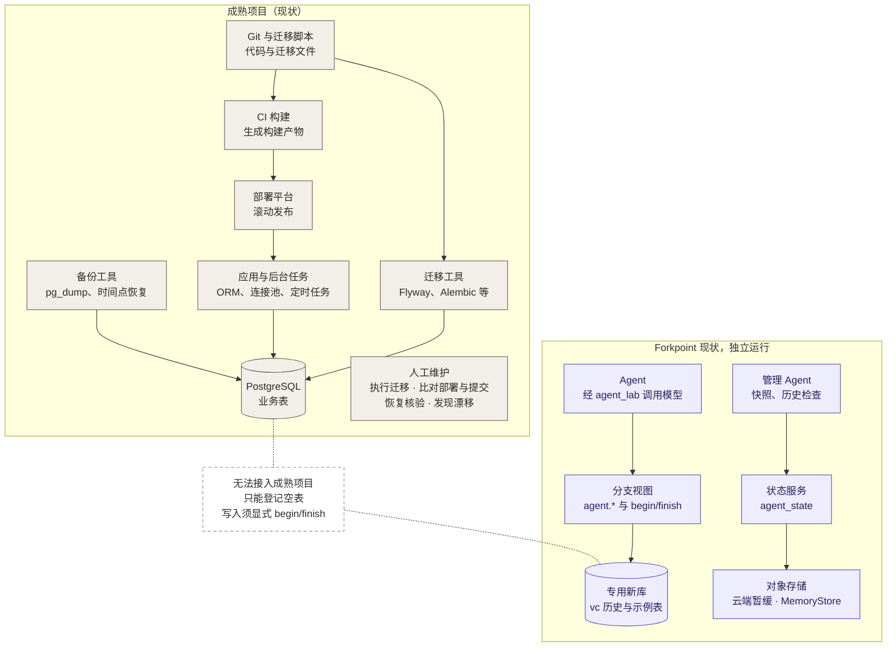
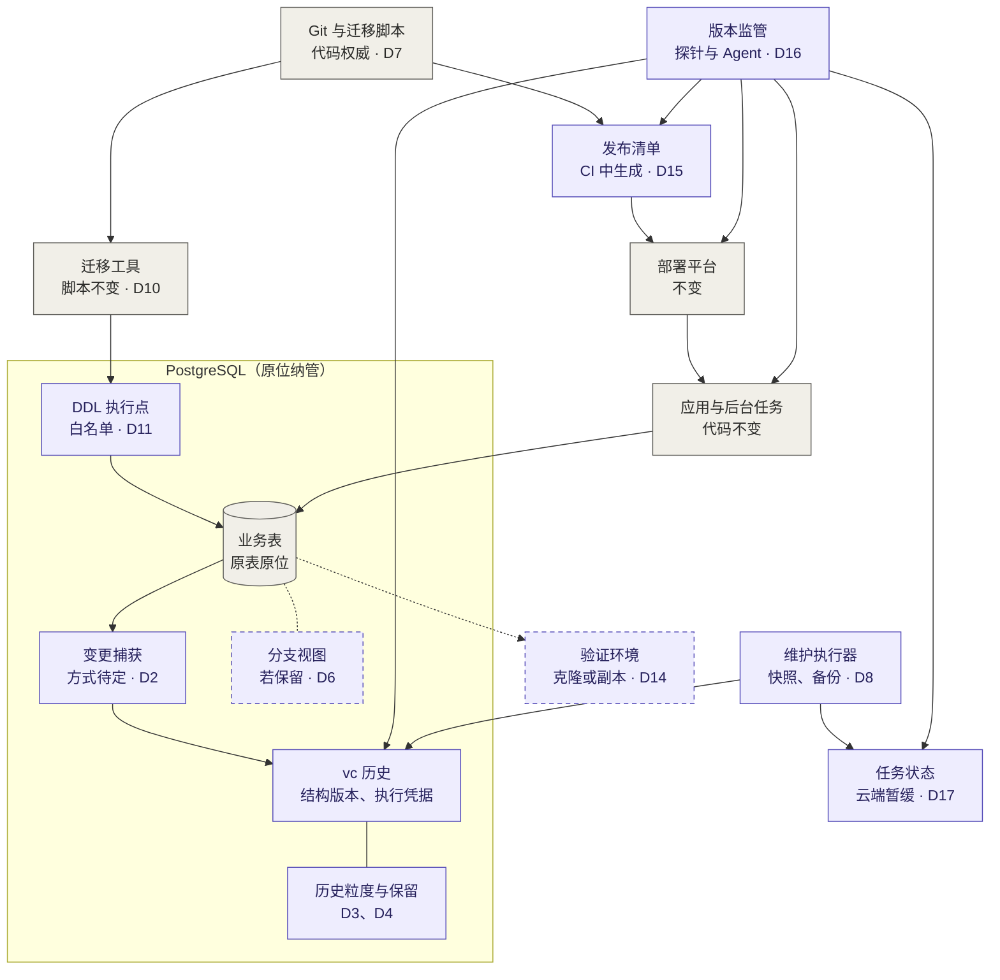
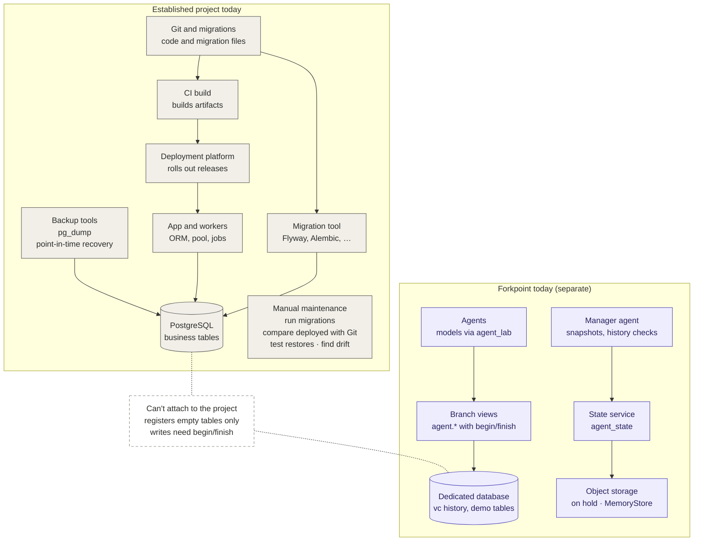
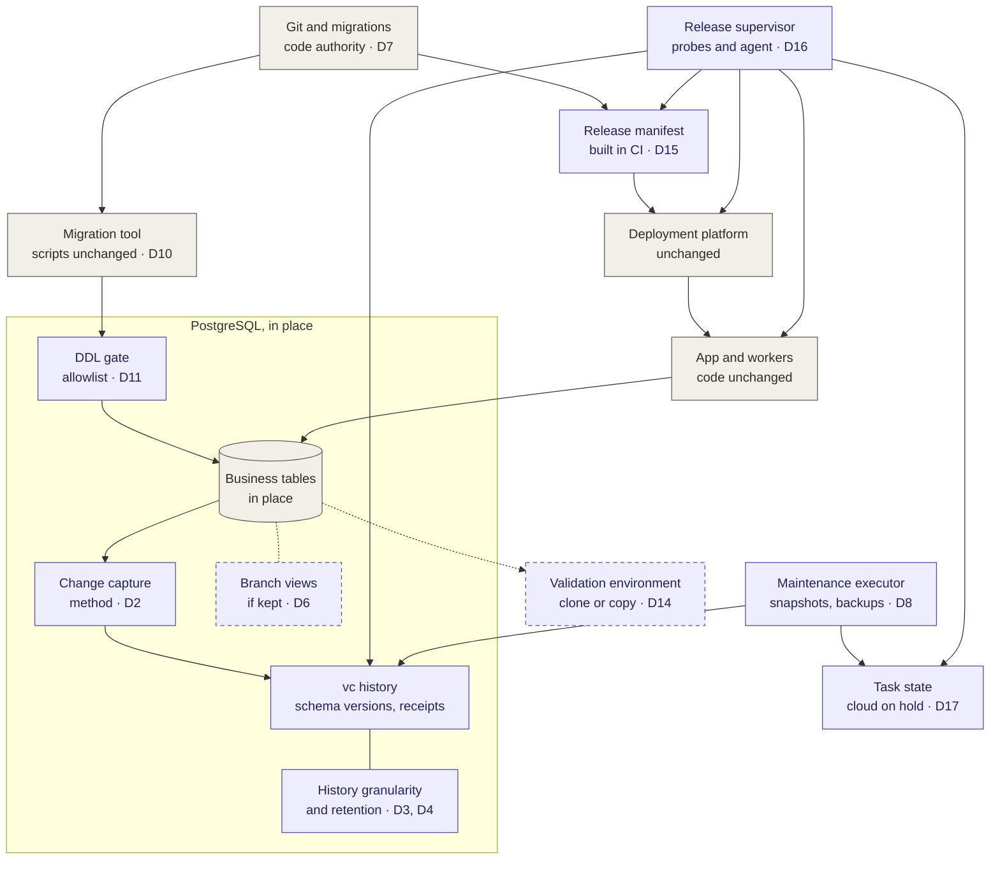

中文 | [English](#english-version)

# 成熟项目低成本接入与数据库维护接管

日期：2026-10-25；同日按设计审查修订。状态：用户方向已确定；以下成本清单、决策、门槛和研发任务均为计划，尚未实现，为这些文档也没有运行任何测试。代码基线：`c281b37cec116a03e6b2a98b42418fe373d86bf3`。本文是三份计划的入口，另两份为[结构与迁移](SCHEMA_EVOLUTION_PLAN.md#chinese-version)和[版本监管](RELEASE_VERSION_SUPERVISION.md#chinese-version)；决策 D1–D17 与门槛 G0–G8 在三份文档中统一编号，每项只在一处定义。

## 1. 已确定的产品边界

1. 目标是让成熟项目以低成本、尽可能零业务代码改动接入 Forkpoint，把数据库版本、结构演进、运行核对和日常维护交给系统，减少人工维护。
2. 通用多 Agent 编程协调、接口协商、测试编排、审查、合并队列和记忆产品保持现状，不为这些能力另起开发工作；必要时复用已有开源工具。这不限制本文的数据库接入能力和用户提出的专用版本监管 Agent。分支工作区是否保留在接入路径中待定（D6）。
3. 继续使用既有 PostgreSQL，不要求用户先搬到新引擎；是否替换底层引擎以后由兼容性和负载证据决定。
4. 后续工作按任务单独交付。这些计划不代表已获准采购、访问真实云服务或修改生产数据库；云端部署仍暂缓。

### 接入前与接入后的架构

灰色是项目现有部分，紫色是 Forkpoint，虚线框表示其是否存在或采用何种形式取决于所注明的决策（Dn）。

接入前，成熟项目与 Forkpoint 是两个互不相连的系统，迁移、版本比对、恢复核验和漂移发现靠人工完成：

接入后（计划，未实现），Forkpoint 在原库中原位纳管，应用代码、迁移脚本和部署平台保持不变；日常维护交给维护执行器和版本监管，仍需人工的事项按 C11 报告。方框位置只表示功能所在之处，不代表已选定选项：若 D11 选 (a)，DDL 执行点包在迁移工具外、位于库外；若 D2 选 (c)，捕获在提交后读取 WAL。

## 2. 现有引擎对接入的约束

以下事实来自基线代码；标为"实测"的行为是 2026-10-25 在本机 PostgreSQL 16 的一次性测试库中观察到的（`app.products` 10 万行，head 处有快照），未保留结果文件。

| 事实 | 对接入的影响 |
|---|---|
| 已登记表的写入必须在同一事务中先调用 `vc.begin_change`，否则捕获触发器报错（`vc._capture_main` 调用 `vc._context`，见 [001_core.sql](../sql/001_core.sql)；实测 P0001）。 | 登记后，未改动的应用完全无法写入，除非捕获机制自行开启 changeset（C03、D2）。 |
| `vc.begin_change` 对 main 的 `vc.branch` 行加锁直到提交（[010_unknown_branch_code.sql](../sql/010_unknown_branch_code.sql)）；实测：第二个版本化事务即使改的是另一行，也在该锁上超时。 | 若每个业务事务都这样捕获，main 就成为单写者，违背 AGENTS.md"避免跨任务全局写锁"的约束。这是 C03 的 P0 问题，不是 C10 以后再测的事项。 |
| 每个事务一个 changeset；每次行变更以 JSON 保存整行的前后值；快照复制全部行；历史表拒绝 DELETE（`immutable` 触发器）；管理 Agent 在可达 changeset 达到 20,000 个时报告（[maintenance.py](../agent_state/maintenance.py)）。 | 按生产写入速率很快越线（每秒 200 个事务的应用 100 秒即达到），存储是原表的数倍，而清理与不可变规则冲突（D3、D4）。 |
| 分支视图（`agent.<表名>`）每次查询都经 `vc.visible_rows` 重建整张表，不使用索引；分支上每次插入或改主键都在重建后的整表上查重（`vc._overlay_write`）。 | 分支读写成本随表的大小增长，而不是随变更量增长（G3）。 |
| 实测分支视图：`INSERT … ON CONFLICT (id)` 报 42P10；省略 `bigserial` 主键报 23502，因为视图不继承列默认值；登记另一 schema 中的同名表报 42P07。按代码，分支上只检查主键唯一；其他 UNIQUE、CHECK、NOT NULL 和外键在合入 main 时才检查。 | ORM 生成的 SQL 不能原样在分支上运行；C04 需要另一种分支实现，而不只是会话适配（D6）。 |
| 代码文件的版本保存在数据库中（`vc.write_file`），与行变更原子提交。 | 若以 Git 为代码权威（C07），这种原子性不再提供（D7）。 |

## 3. "零成本"拆成可测目标

首要目标为**零业务代码改动、零业务 SQL 改写、零数据库引擎搬迁**。安装、授权、配置、性能、存储和维护仍逐项计量；这些没有测量为零之前，不将"零代码改动"宣传为"总成本为零"。

| 指标 | 验收目标或测量方式 |
|---|---|
| 业务代码/SQL 改动量 | 在明确支持的组合上均为 0；适配器、基础设施和配置改动另外列出，不能转移后隐藏。 |
| 数据搬迁量 | 原生产数据库原位接入为目标；历史基线、验证副本、备份的复制量仍计入 I/O 和空间成本。 |
| 用户操作量 | 记录手工步骤、必要输入、总耗时、管理员时间及后续每月介入次数；由安装器自动发现可发现的配置。 |
| 可用性与性能 | 接入/退出停写时长、最大锁等待、p50/p95/p99 延迟、吞吐、WAL/写放大、CPU/内存/磁盘；先与原项目基线比较。 |
| 正确性 | 已提交业务写入无丢失或重复；数据库约束、事务边界、权限及应用行为保持；测试覆盖的限制明确列出。 |
| 持续成本 | 历史/快照增长、备份和恢复时间、云存储请求、模型调用及人工维护；不能只比较安装命令数量。 |

零改动是对经过验证的技术栈组合的承诺，不是先承诺兼容任意 SQL、ORM、扩展和托管平台。预算在 G0 与试点项目一起固定；当前不编造通用数值。

## 4. 待用户决定的事项

每项决策在用户选择前保持未定；"决定前需要"一列给出应先具备的证据。选择会改变部分 P0 任务的范围，第 5 节的"依赖"列给出对应关系。D10–D14 见[结构计划](SCHEMA_EVOLUTION_PLAN.md#chinese-version)第 6 节，D15–D17 见[监管计划](RELEASE_VERSION_SUPERVISION.md#chinese-version)第 6 节。

| ID | 决策 | 选项及后果 | 阻塞 | 决定前需要 |
|---|---|---|---|---|
| D1 | 试点项目 | 选哪个项目，及其 ORM、迁移工具、连接池、后台写入、托管方式（自管或托管服务）和部署平台。这些决定 C03、C04、S1、R0 要做哪些适配器，以及可用的权限。 | G0 及以下全部验收 | 对候选项目做 C01 只读盘点 |
| D2 | main 历史的捕获方式 | (a) 现有触发器，每个事务一次 `begin_change`：历史在提交内封口；main 成为单写者；需要无需改代码的提交时封口机制。(b) 触发器在业务事务内暂存行变更但不取分支锁，提交后由排序器按提交顺序生成 changeset：不漏行、无全局锁，但 main 历史在提交后封口。(c) 提交后的逻辑解码：业务表上无触发器，不进入写路径；需要 `wal_level=logical`（未设置时要重启服务器）、REPLICATION 权限和复制槽，并监控复制槽保留的 WAL；main 上没有提交内校验。(d) 用 C 扩展在提交前回调中封口：无需改代码即可在提交内封口；多数托管服务不允许加载这类扩展。 | C02、C03、C10、C12、D3、D5 | G1 |
| D3 | main 上 changeset 的粒度 | (a) 每个业务事务一个（autocommit 下每条语句一个）。(b) 按时间或数量成批：changeset 数量有界；批内各事务的归属与顺序丢失，或需另存为元数据。 | C10、R1 的历史读取 | G2 |
| D4 | 历史保留 | (a) 保留全部封口历史：存储无上限增长。(b) 在保留线以下清理：需要对"封口历史不可变"设立显式例外（用浅根替换被清理的祖先，再删除目前受 `immutable` 触发器保护的行），并规定引用被清理 revision 的分支、发布和证据如何处理。(c) 冷历史归档到库外，库内保留引用。 | C10、C11 | G2 |
| D5 | 写路径失败策略（仅当 D2 让捕获进入写路径） | (a) 失败即中止：捕获出错时业务事务回滚；Forkpoint 故障或磁盘满即成为应用故障。(b) 失败放行：业务写入继续，该表标为未完整版本化，需重新建立基线（C02）后才恢复保证。(c) 按表选择。 | A1、C03、C12 | G4 |
| D6 | 分支工作区是否保留在接入路径 | (a) 对生产表保留：需要新的分支实现（按分支建索引的存储或写时复制），以及默认值、UPSERT 和约束行为，工作量大。(b) 只用于预算内的小表或参考数据表。(c) 从接入中移除；验证环境由[结构计划](SCHEMA_EVOLUTION_PLAN.md#chinese-version)的 S3 与 D14 提供。最初引入分支的多 Agent 场景不在这些计划内。 | C04、结构计划第 4 节、S3 | G3 |
| D7 | 代码的权威来源 | (a) Git：Forkpoint 保存 Git SHA，发布清单把它与 Forkpoint revision 对应；不再有代码与数据的原子提交，文档须写明替代办法（例如同时列出两者、部署时核对的清单）。(b) Forkpoint：需要导入代码，不是零成本。(c) 按项目选择。 | C07、R0 | D1 |
| D8 | 每项能力自建还是集成 | 见下表。 | S0、S1、S3、C11、R1 | D1 |
| D9 | 纳管表集合与外键 | (a) 只纳管在外键上闭合的表集合。(b) 允许部分集合：沿外键读到未纳管表时标为未固定版本，固定版本的验证数据会混合不同时点。 | C02、A1、S3 | C01 的外键闭包报告 |

D8 的候选：

| 能力 | 可考虑的现有工具 | 只有 Forkpoint 能补的部分 | 选择 |
|---|---|---|---|
| 结构读取与漂移检测（S0、结构计划 P0 行） | Atlas `schema inspect` / `schema diff`；规范化的 `pg_dump --schema-only` | 与行历史绑定的稳定列身份 | 待定 |
| 迁移顺序、已执行状态与校验和（S1） | 项目自己的工具（Flyway、Liquibase、Alembic、Atlas、Rails migrations）；Flyway 已按校验和拒绝被改过的脚本 | 把迁移与结构版本、Forkpoint revision 关联起来的执行凭据 | 待定 |
| 在线纳管的变更捕获（C02） | PostgreSQL 逻辑解码（`pgoutput`）、Debezium | 把捕获的变更封口为 changeset | 待定 |
| 备份、时间点恢复与恢复核验（C11） | pgBackRest、WAL-G、平台自带的时间点恢复 | 同时核对历史一致性的恢复演练 | 待定 |
| 验证副本（S3） | 平台克隆（Neon 分支、Aurora 克隆）、文件系统快照、`pg_dump` / `pg_restore` | 为已纳管表装载固定 revision 的数据 | 待定 |
| 目标发布与运行发布（R1） | Kubernetes Deployment 的状态条件（`progressDeadlineSeconds`）、Argo CD 或 Flux、平台自身的状态 | 结构与参考数据兼容这一环 | 待定 |
| 行历史、固定版本读取、带约束校验的合入、带版本的参考数据 | 此处未列出等价工具 | Forkpoint 核心 | 保留 |

## 5. 具体成本与消除任务

优先级 P0 为接入前置，P1 为完整受管闭环，P2 为规模与覆盖扩展。下列项均未完成。

| ID / 优先级 | 当前成本或缺口 | 需要做的工作 | 验收证据 | 依赖 |
|---|---|---|---|---|
| C01 / P0 | 用户需自己判断项目是否兼容 | 只读盘点版本、表类型、扩展、RLS、触发器、迁移工具、ORM、连接池、后台写入与权限；另报告候选纳管集合的外键闭包，以及 D2 各选项所需的权限级别 | 输出支持/不支持/未知清单、最小授权和明确改动预览；盘点无业务副作用 | 无；可在 G0 前用于选择 D1 |
| C02 / P0 | 当前只能登记空表，已有数据需导入 | 原位纳管、完整基线、并发写入接续和可中断续跑；边界取决于 D2（逻辑解码用 LSN，触发器方案需要自己的可靠边界） | 带并发写入的基线核验；无丢失、重复或历史缺口；不要求清空/重建业务表 | D2、D9、G1 |
| C03 / P0 | 写入必须显式 begin/finish；未改动的应用写已登记表会失败（第 2 节） | 按 D2 实现自动捕获、归属和封口，保留当前显式 API。连接池以同一角色连接时，归属需要每个连接的标记（`application_name` 或由连接池/驱动设置的会话参数），这属于适配器工作 | 原项目业务代码/SQL 不变；提交/回滚、保存点、延迟触发器及重试保持；吞吐和锁等待在 G0 预算内 | D2、D5、G1 |
| C04 / P0（仅当 D6 保留分支） | 分支视图需手动适配，且不接受 ORM 生成的 SQL（第 2 节） | 按 D6 实现新的分支存储或限定范围；连接/事务级工作区选择、池复用清理、预编译语句与错误码兼容 | 真实连接池反复复用无串分支；无工作区标记的生产连接仍明确指向 main；试点 ORM 的语句在分支上通过 | D6、G3 |
| C05 / P1 | 固定 schema，迁移需人工处理 | 交付[结构计划](SCHEMA_EVOLUTION_PLAN.md#chinese-version) S0–S4 中逐步支持的部分 | 既有迁移目录继续使用，漂移可见，旧版本可读；未支持操作显式拒绝 | D10–D14 |
| C06 / P1 | identity/generated、分区、无主键等不兼容 | 逐类支持：序列分配、生成表达式、分区身份和约束；无主键表另定稳定身份，不能默默加列 | 原有自增/RETURNING/UPSERT/外键行为符合约定；不支持项不得计入全面纳管成功 | D2 |
| C07 / P1 | 数据库内代码版本与 Git 两份流程 | 按 D7 处理；复用现有 Git/CI，自动记录源码、产物和数据/结构引用 | 用户不用复制代码到第二套仓库；关联可核验；写明放弃了哪种原子性 | D7 |
| C08 / P1 | 人工比对提交版本与实际发布 | 按[版本监管计划](RELEASE_VERSION_SUPERVISION.md#chinese-version)交付 | 见该计划 R0–R3 | D15–D17 |
| C09 / P1 | 管理状态真实持久化未验证 | 云端工作恢复安排后，联调既定后端、凭据、网络失败与冷恢复 | 真实进程/主机中断可恢复；SDK 替身和 MemoryStore 结果单列 | 云端工作另行安排 |
| C10 / P0（G2 推算）、P1（清理） | 历史/快照增长（main 锁问题已移入 C03） | 用试点负载测量增长、维护快照；按 D4 定义可达性、保留期、清理与空间上限 | G2 推算在预算内；若选 D4 (b)，清理不破坏活跃分支、发布、证据引用及恢复窗口 | D3、D4、G2 |
| C11 / P1→P2 | 仍需人工做备份、恢复、健康和容量维护 | 按 D8 复用现有能力，增加可核查的维护执行器、恢复演练、容量策略和兼容升级 | 故障被发现并按策略处理；备份经过恢复验证；报告仍需人工的事项，不把备份文件存在当作恢复成功 | D8 |
| C12 / P0→P1 | 安装权限、现有安全规则、退出成本 | 最小权限的下限由 D2 决定：捕获触发器需要表属主权限，PostgreSQL 16 上事件触发器需要超级用户，逻辑解码需要 REPLICATION。保留 RLS/授权；设计停止纳管、清理适配及历史导出 | 退出后原应用继续写入；撤销角色不破坏业务权限；保留数据和必要历史，不留下阻断写入的捕获机制 | D2、D5 |

本表指明要消除的成本，不将其转嫁为用户必须手写的每表协议。实现可拆成核心、框架适配、运维适配，但每个适配器本身的升级维护成本也纳入验收。

## 6. 最难的两个前置问题

**原位纳管已有表。** 支持两条明确区分的路径：短暂停写下建立一致基线；或者一致快照加增量捕获，再在可证明的边界完成追平和切换。在线路径必须证明快照与变更流没有空隙、事务有序且重放可去重。边界取决于 D2：逻辑解码以 LSN 为边界，触发器方案需要自己的可靠边界。长快照和复制槽会保留资源，这部分成本不能隐藏。[逻辑解码参考](https://www.postgresql.org/docs/16/logicaldecoding-explanation.html)

在基线和接续完全验证前，不把该表标为完整版本化。记录纳管起点，不声称恢复了接入之前的全部历史。恢复原运行方式不得丢弃纳管期间已经提交的业务写入。

**零业务改动下的事务捕获。** G1 需按 D2 的选项检验以下风险：

- PL/pgSQL 没有提交前钩子。选项 (a) 在库内唯一的封口点是延迟约束触发器：应用执行 `SET CONSTRAINTS ALL IMMEDIATE` 会让它在事务中途触发，此后应用排入的延迟触发器在封口之后才执行，还可能继续写行。现有的 `finish_required` 就是这种触发器，同一条语句今天也会让它提前触发。
- 选项 (d) 用 C 层的提交前回调避开这一问题，但需要可加载的扩展。
- 选项 (b) 和 (c) 在提交后封口。提交后的捕获不能拦截已经提交的冲突，不得标为与提交内校验等价。
- autocommit 的每条语句是一个版本单位；跨事务的业务操作和应用二进制发布都不能自动推断。sequence 值不随事务回滚，identity 支持需要单独策略。[序列参考](https://www.postgresql.org/docs/16/functions-sequence.html)
- 连接池使用同一角色时，归属需要每个连接的标记。

不用 SQL 字符串替换冒充透明兼容；代理方案只有在协议、预编译语句及事务兼容得到证明后才考虑。若某个技术栈上没有选项能在预算内通过 G1，就收回该栈的零代码改动承诺，如实报告所需的适配器成本。

## 7. 分阶段接入和退出

| 阶段 | 用户体验目标 | 实际保证与退出 |
|---|---|---|
| A0 只读评估 | 指定连接和项目，自动盘点与列成本 | 不改变写入、不提供版本强制保证；停止探针即可退出。不能用此阶段证明完整零成本接入。 |
| A1 部分纳管 | 选择已支持范围，自动基线和安装适配 | 对已验证表/写入路径提供约定保证；未纳管范围可见；捕获失败按 D5 处理。退出先完成在途事务和记录接续，再解除捕获要求。 |
| A2 维护接管 | 保留现有迁移/部署流程，接入结构演进与版本监管 | 自动处理已授权且可验证的动作；恢复能力与覆盖范围有报告。停监管不会自动删除业务结构或数据。依赖 D17。 |
| A3 扩大覆盖 | 扩展表类型、框架和规模，减少日常人工 | 每种组合独立验收；依赖升级后验证兼容，不默认继承旧结论。 |

安装包应给出预览、幂等安装、状态检查、失败恢复和退出入口；这些是待实现能力，本文不提供可直接执行的虚构命令。托管数据库权限不足时，明确能提供哪一级服务。

## 8. 门槛与验证

| 门槛 | 在此之前 | 检查 | 产出 |
|---|---|---|---|
| G0 试点与预算 | 这些计划中的任何验收 | 已选定 D1；固定写延迟/吞吐、停写时长、锁等待、存储增长和权限级别的预算 | 经用户确认的预算记录 |
| G1 捕获探针 | 实现 C02/C03；决定 D2 | 在专用测试库中按试点的结构和写入形态，对仍在考虑的每个 D2 选项：测量相对无捕获时的吞吐与锁等待；运行封口用例（`SET CONSTRAINTS ALL IMMEDIATE`、在封口点之后仍写行的延迟触发器、保存点回滚、事务中途断连、autocommit、COPY）；确认试点托管环境可用的权限 | 每个选项逐项的通过/失败及实测成本。漏行、封口后追加或超出预算的选项在该技术栈上淘汰 |
| G2 历史推算 | 决定 D3、D4 | 试点写入速率 × 每次捕获的字节数 × 保留期；到达 20,000 个 changeset 报告所需的时间；快照成本 | 各 D3/D4 选项下的存储量和越线时间 |
| G3 分支可行性（仅当 D6 选 a 或 b） | C04 | 试点表规模下的分支读写成本；试点 ORM 的语句（UPSERT、省略默认值、带 schema 限定的表名、`SELECT … FOR UPDATE` 是否真正加锁）经分支视图执行 | 逐条语句的通过/失败与成本曲线 |
| G4 失败与退出演练 | 任何表进入 A1 | 注入捕获失败（函数报错、磁盘满、锁超时），确认行为符合 D5；在写入持续时退出 | 观察到的行为与 D5 一致；退出后应用可写 |

首批验证使用同一 PostgreSQL 16 服务的专用测试库，覆盖：原始 SQL 应用、一个 ORM 与迁移工具组合、一个带连接池和后台任务的服务。框架按 D1 选择，不先扩展到所有生态。基线必须包含已有数据和实际查询/写入形态，不只测新建空表。

所有样例检查：事务提交/失败/重试、savepoint、autocommit、COPY、UPSERT/RETURNING、外键和延迟约束、连接池复用、数据库重启、迁移、备份恢复和退出。特殊表/扩展/RLS 若未支持，报告为未覆盖；不关闭它们来换取通过。

每轮记录成本指标、G0 固定的预算、源码/配置/数据集版本、实际结果和失败。只有在业务行为等价、版本记录完整、性能/可用性预算通过、退出成功后，才宣称该组合支持低成本接入。预算或正确性未通过时，返回具体 Cxx 缺口及修复任务。

顺序：C01（随时可做，用于选择 D1）→ G0 → G1 → 用户决定 D2–D5 → C02–C04、C12 → 按各自门槛推进结构计划 S0/S1 和监管 R0/R1。C09 的真实云端工作等待单独安排。通用编程协作功能不进入这份开发队列。

---

[中文](#chinese-version) | English

# Low-Cost Adoption and Database Maintenance for Established Projects

Date: October 25, 2026; revised the same day after a design review. Status: user direction confirmed; the cost inventory, decisions, gates and tasks below are plans, nothing is implemented, and no test was run for these documents. Code baseline: `c281b37cec116a03e6b2a98b42418fe373d86bf3`. This is the entry document for three plans; the others are [schema and migrations](SCHEMA_EVOLUTION_PLAN.md#english-version) and [release supervision](RELEASE_VERSION_SUPERVISION.md#english-version). Decisions D1–D17 and gates G0–G8 are numbered across all three, and each is defined in one place.

## 1. Agreed product boundaries

1. Enable established projects to adopt Forkpoint at low cost, with zero business-code changes wherever possible, delegating database versioning, schema evolution, runtime reconciliation, and routine maintenance to reduce manual work.
2. General multi-agent coding coordination, interface negotiation, test orchestration, review, merge queues, and memory products remain unchanged. Do not start new development for those capabilities; reuse existing open-source tools when needed. This does not exclude database integration or the dedicated release supervisor requested by the user. Whether branch workspaces stay in the adoption path is open (D6).
3. Continue using the existing PostgreSQL engine rather than requiring migration to another engine. Any later engine replacement depends on compatibility and workload evidence.
4. Future work is delivered task by task. These plans do not authorize procurement, real cloud access, or production database changes; cloud deployment remains on hold.

### Architecture before and after adoption

Gray marks the project's existing parts and purple marks Forkpoint; a dashed box exists, or takes its form, according to the decision it names (Dn).

Before adoption, the established project and Forkpoint are two unconnected systems, and migrations, version comparison, restore checks, and drift detection are done by hand:

After adoption (planned, not implemented), Forkpoint is enrolled in the existing database, and the application code, migration scripts, and deployment platform stay unchanged. Routine maintenance moves to the maintenance executor and the release supervisor, and remaining manual work is reported under C11. Box positions show where a function sits, not which option is chosen: under D11 (a) the DDL gate wraps the migration tool outside the database, and under D2 (c) capture reads the WAL after commit.

## 2. What the current engine implies for adoption

These facts come from the code at the baseline. Behaviors marked "observed" were seen on 2026-10-25 in a throwaway test database on the local PostgreSQL 16 (100,000 rows in `app.products`, with a snapshot at head); no result file was kept.

| Fact | Consequence for adoption |
|---|---|
| A write to a registered table fails unless the same transaction called `vc.begin_change` (`vc._capture_main` calls `vc._context`, in [001_core.sql](../sql/001_core.sql); observed P0001). | After registration, an unchanged application cannot write at all until capture opens changesets itself (C03, D2). |
| `vc.begin_change` locks main's `vc.branch` row until commit ([010_unknown_branch_code.sql](../sql/010_unknown_branch_code.sql)). Observed: a second versioned transaction updating a different row timed out on that lock. | Capturing every business transaction this way makes main a single writer, against AGENTS.md's rule to avoid global write locks. This is a P0 question for C03, not a later C10 measurement. |
| One changeset per transaction; each row change stores the whole row as JSON before and after; snapshots copy every row; history tables reject DELETE (`immutable` triggers); the manager reports at 20,000 reachable changesets ([maintenance.py](../agent_state/maintenance.py)). | Production write rates reach the report quickly (an application with 200 transactions per second passes it in 100 seconds), storage is a multiple of the table, and pruning conflicts with immutability (D3, D4). |
| Branch views (`agent.<table>`) rebuild the whole table through `vc.visible_rows` for every query, without indexes; every insert or key change on a branch checks for duplicates over the whole rebuilt table (`vc._overlay_write`). | Branch read and write cost grows with table size, not with the size of the change (G3). |
| Observed on branch views: `INSERT … ON CONFLICT (id)` fails (42P10); omitting a `bigserial` key fails (23502) because views do not inherit column defaults; registering a same-named table from another schema fails (42P07). From the code, only primary-key uniqueness is checked on a branch; other UNIQUE, CHECK, NOT NULL, and foreign-key constraints are checked when merged into main. | ORM-generated SQL does not run unchanged on a branch. C04 needs a different branch implementation, not only session plumbing (D6). |
| Code files are versioned in the database (`vc.write_file`) and commit atomically with row changes. | If Git remains the authority for code (C07), that atomicity is no longer available (D7). |

## 3. Make zero-cost goals measurable

Primary targets are **zero business-code changes, zero business-SQL rewrites, and zero database-engine migration**. Measure installation, privileges, configuration, performance, storage, and maintenance separately. Zero code changes must not be marketed as zero total cost without evidence for the other dimensions.

| Metric | Acceptance target or measurement |
|---|---|
| Business code/SQL edits | Both zero for explicitly supported combinations; disclose adapter, infrastructure, and configuration changes separately rather than hiding displaced work. |
| Data movement | Aim for in-place enrollment of the production database; count baseline, validation-copy, and backup I/O and space. |
| User effort | Manual steps, required inputs, elapsed time, administrator time, and monthly interventions; installers discover what can be discovered automatically. |
| Availability/performance | Write pauses during entry/exit, maximum lock waits, p50/p95/p99 latency, throughput, WAL/write amplification, CPU, memory, and disk against the original application baseline. |
| Correctness | No lost or duplicated committed business writes; preserve constraints, transaction boundaries, permissions, and application behavior; disclose coverage limits. |
| Ongoing cost | History/snapshot growth, backup/recovery time, cloud requests, model calls, and human maintenance—not just installation command count. |

Zero-change claims apply to verified technology combinations, not arbitrary SQL, ORMs, extensions, or hosted platforms. Budgets are fixed with the pilot project at G0; no universal numbers are invented here.

## 4. Decisions left to the user

Each decision stays open until the user chooses. "Settle with" names the evidence that should exist first. A choice can change the scope of P0 items; the "Depends on" column in section 5 shows which. D10–D14 are in section 6 of the [schema plan](SCHEMA_EVOLUTION_PLAN.md#english-version), D15–D17 in section 6 of the [supervision plan](RELEASE_VERSION_SUPERVISION.md#english-version).

| ID | Decision | Options and consequences | Blocks | Settle with |
|---|---|---|---|---|
| D1 | Pilot project | Which project, and its ORM, migration tool, connection pool, background writers, hosting (self-managed or a managed service), and deployment platform. These choose the adapters C03, C04, S1, and R0 build and the privileges available. | G0 and every acceptance below | C01 read-only inventory of candidates |
| D2 | How main's history is captured | (a) The current trigger with one `begin_change` per transaction: history is sealed inside the commit; main becomes a single writer; needs a way to seal at commit without code changes. (b) Triggers stage row changes inside the business transaction without the branch lock, and a sequencer turns them into changesets in commit order after commit: no lost rows and no global lock, but main's history is sealed after commit. (c) Logical decoding after commit: no triggers on business tables and nothing in the write path; needs `wal_level=logical` (a server restart if not already set), the REPLICATION privilege, and a replication slot whose retained WAL must be monitored; no validation inside the commit on main. (d) A C extension that seals in a pre-commit transaction callback: in-commit sealing without code changes; most managed services will not load such an extension. | C02, C03, C10, C12, D3, D5 | G1 |
| D3 | Changeset granularity on main | (a) One per business transaction (one per statement under autocommit). (b) Batches by time or count: a bounded changeset count; attribution and order of the transactions inside a batch are lost or must be kept as metadata. | C10, R1 history reads | G2 |
| D4 | History retention | (a) Keep all sealed history: storage grows without bound. (b) Prune below a retention horizon: needs an explicit exception to "sealed history is immutable" (a shallow root replacing pruned ancestors, then deleting rows the `immutable` triggers protect today), and rules for branches, releases, and evidence that reference pruned revisions. (c) Archive cold history outside the database and keep references. | C10, C11 | G2 |
| D5 | Write-path failure policy (only if D2 puts capture in the write path) | (a) Fail closed: a capture error rolls back the business transaction; a Forkpoint fault or a full disk becomes an application outage. (b) Fail open: business writes continue, the table is marked not fully versioned, and a new baseline (C02) is needed before guarantees return. (c) Per table. | A1, C03, C12 | G4 |
| D6 | Branch workspaces in the adoption path | (a) Keep them for production tables: needs a new branch implementation (indexed per-branch storage or copy-on-write) plus defaults, UPSERT, and constraint behavior; large work. (b) Limit them to small or reference tables within a size budget. (c) Remove them from adoption; validation environments come from S3 and D14 in the [schema plan](SCHEMA_EVOLUTION_PLAN.md#english-version). The multi-agent use that motivated branches is outside these plans. | C04, schema plan section 4, S3 | G3 |
| D7 | Source of truth for code | (a) Git: Forkpoint stores Git SHAs and the release manifest maps them to Forkpoint revisions; atomic code-and-data commits are dropped, and the docs must say what replaces them (for example, a manifest that names both and is checked at deployment). (b) Forkpoint: code must be imported, which is not zero cost. (c) Per project. | C07, R0 | D1 |
| D8 | Build or integrate, per capability | See the table below. | S0, S1, S3, C11, R1 | D1 |
| D9 | Enrollment sets and foreign keys | (a) Enroll only sets of tables closed under foreign keys. (b) Allow partial sets: reads that follow a foreign key into an unenrolled table are marked unpinned, and pinned validation data mixes points in time. | C02, A1, S3 | C01 foreign-key closure report |

Candidates for D8:

| Capability | Existing tools to consider | What only Forkpoint adds | Choice |
|---|---|---|---|
| Schema inspection and drift (S0, P0 row of the schema plan) | Atlas `schema inspect` / `schema diff`; normalized `pg_dump --schema-only` | Stable column identities bound to row history | open |
| Migration ordering, applied state, and checksums (S1) | The project's own tool (Flyway, Liquibase, Alembic, Atlas, Rails migrations); Flyway already rejects a changed script by checksum | Receipts linking a migration to schema versions and Forkpoint revisions | open |
| Change capture for online enrollment (C02) | PostgreSQL logical decoding (`pgoutput`), Debezium | Sealing captured changes into changesets | open |
| Backup, point-in-time recovery, and restore checks (C11) | pgBackRest, WAL-G, the platform's point-in-time recovery | Restore drills that also check history consistency | open |
| Validation copies (S3) | Platform clones (Neon branches, Aurora cloning), filesystem snapshots, `pg_dump` / `pg_restore` | Loading pinned-revision data for enrolled tables | open |
| Desired versus running release (R1) | Kubernetes Deployment conditions (`progressDeadlineSeconds`), Argo CD or Flux, the platform's own status | The schema and reference-data compatibility link | open |
| Row history, pinned reads, constraint-checked merges, versioned reference data | None named here | Forkpoint core | keep |

## 5. Concrete costs and removal tasks

P0 denotes adoption prerequisites, P1 a complete managed workflow, and P2 scale/coverage expansion. No item is complete.

| ID / priority | Current cost or gap | Required work | Acceptance evidence | Depends on |
|---|---|---|---|---|
| C01 / P0 | Users assess compatibility themselves | Read-only inventory of versions, tables, extensions, RLS, triggers, migration tools, ORMs, pools, background writers, and privileges; also report the foreign-key closure of candidate enrollment sets and the privilege tier each D2 option needs | Supported/unsupported/unknown inventory, minimum privileges, explicit change preview; no business side effects | None; can run before G0 to choose D1 |
| C02 / P0 | Only empty tables can be registered; existing data must be imported | In-place enrollment, complete baseline, concurrent-change continuity, resumable setup; the boundary depends on D2 (LSN for logical decoding; a trigger-based design needs its own reliable boundary) | Verify under concurrent writes; no loss, duplication, or history gaps; no emptying/recreating business tables | D2, D9, G1 |
| C03 / P0 | Writes require explicit begin/finish; unchanged applications fail on registered tables (section 2) | Automatic capture, attribution, and sealing according to D2; retain the explicit API. When a pool connects as one role, attribution needs a per-connection marker (`application_name` or a setting the pool or driver sets), which is adapter work | Unchanged business code/SQL; preserve commit/rollback, savepoints, deferred triggers, and retries; throughput and lock waits within the G0 budgets | D2, D5, G1 |
| C04 / P0 (only if D6 keeps branches) | Branch views need manual adaptation and do not accept ORM-generated SQL (section 2) | New branch storage or a limited scope according to D6; connection/transaction workspace selection, pool cleanup, prepared-statement and error-code compatibility | Reused pooled connections never leak branch state; unmarked production connections explicitly remain on main; the pilot ORM's statements pass on a branch | D6, G3 |
| C05 / P1 | Fixed schema requires manual migration handling | Deliver supported portions of S0–S4 in the [schema plan](SCHEMA_EVOLUTION_PLAN.md#english-version) | Existing migration directories remain usable; visible drift and readable old versions; explicit unsupported-operation errors | D10–D14 |
| C06 / P1 | Identity/generated columns, partitions, and keyless tables are incompatible | Support each category: sequence allocation, expressions, partition identity/constraints; define stable identity for keyless tables without silently adding columns | Agreed auto-ID/RETURNING/UPSERT/foreign-key behavior; unsupported objects cannot count as full enrollment success | D2 |
| C07 / P1 | Database code versions duplicate Git workflows | Follow D7; reuse Git/CI; automatically map source, artifacts, and data/schema references | No manual code copying into a second repository; verifiable mappings; states which atomicity is given up | D7 |
| C08 / P1 | Committed and deployed versions are compared manually | Deliver the [supervision plan](RELEASE_VERSION_SUPERVISION.md#english-version) | See R0–R3 there | D15–D17 |
| C09 / P1 | Formal management-state persistence is unverified | When cloud work resumes, validate the planned backend, credentials, network failure, and cold recovery | Real process/host recovery; report SDK stand-ins and MemoryStore separately | Cloud work scheduled separately |
| C10 / P0 (G2 projection), P1 (pruning) | History/snapshot growth (main locking moved to C03) | Measure growth under the pilot workload, maintain snapshots, and define reachability, retention, pruning, and storage limits according to D4 | G2 projection within budget; if D4 (b) is chosen, pruning preserves active branches, releases, evidence references, and recovery windows | D3, D4, G2 |
| C11 / P1→P2 | Backup, recovery, health, and capacity still require manual work | Reuse existing capabilities according to D8; add verifiable maintenance executors, restore drills, capacity policies, compatible upgrades | Detect and handle failures under policy; restore-test backups; disclose remaining manual work rather than treating backup-file existence as recovery proof | D8 |
| C12 / P0→P1 | Installation privileges, security compatibility, and exit cost | D2 sets the floor for minimum privilege: capture triggers need table ownership, event triggers need superuser on PostgreSQL 16, and logical decoding needs REPLICATION. Preserve RLS/grants; design unenrollment, adapter cleanup, and history export | Original application can write after exit; role removal preserves business permissions; retain data/history without capture mechanisms that block writes | D2, D5 |

The table identifies costs to remove, not protocols users must hand-code per table. Work can be divided among core, framework, and operations adapters, but their own upgrade/maintenance costs also count.

## 6. The two hardest prerequisites

**Enroll populated tables in place.** Offer two explicitly different paths: establish a consistent baseline during a short write pause; or use a consistent snapshot plus incremental capture, then catch up and switch at a provable boundary. The online path must prove snapshot/change-stream continuity, transaction order, and deduplicated replay. The boundary depends on D2: logical decoding uses the LSN, and a trigger-based design needs its own reliable boundary. Long snapshots and replication slots retain resources, and that cost must remain visible. [Logical decoding reference](https://www.postgresql.org/docs/16/logicaldecoding-explanation.html)

Do not mark a table fully versioned until its baseline and continuity are verified. Record the enrollment starting point rather than claiming to reconstruct all earlier history. Returning to the original operation mode must preserve business writes committed during enrollment.

**Capture transactions without business-code changes.** G1 tests these risks for the D2 options:

- PL/pgSQL has no pre-commit hook. In option (a), the only seal point inside the database is a deferred constraint trigger. An application's `SET CONSTRAINTS ALL IMMEDIATE` fires it mid-transaction, and deferred triggers the application queues afterwards run after the seal and may write more rows. The existing `finish_required` check is such a trigger, so the same statement fires it early today.
- Option (d) avoids this with a C-level pre-commit callback but needs a loadable extension.
- Options (b) and (c) seal after commit. Post-commit capture cannot prevent a conflict that already committed and is not equivalent to validation inside the commit.
- Each autocommit statement is a version unit; cross-transaction business operations and application-binary releases cannot be inferred. Sequence values do not roll back with the transaction, so identity support needs its own policy. [Sequence reference](https://www.postgresql.org/docs/16/functions-sequence.html)
- When a pool uses one role, attribution needs a per-connection marker.

SQL string replacement is not transparent compatibility; consider a proxy only after proving protocol, prepared-statement, and transaction compatibility. If no option passes G1 within budget on a stack, withdraw the zero-code claim for that stack and disclose the adapter cost.

## 7. Staged adoption and exit

| Stage | Intended user experience | Actual guarantee and exit |
|---|---|---|
| A0 Read-only assessment | Supply connection/project; inventory and costs are generated | No write changes or enforced version guarantees; stop probes to exit. This stage does not prove complete zero-cost adoption. |
| A1 Partial enrollment | Select supported scope; automate baseline and adapter installation | Agreed guarantees for verified tables/write paths; expose unmanaged scope; capture failures follow D5. Finish in-flight transactions and capture continuity before removing capture requirements. |
| A2 Maintenance delegation | Preserve migration/deployment workflows; connect schema evolution and supervision | Automatically perform authorized, verifiable actions; report recovery capability and coverage. Stopping supervision does not delete business schemas or data. Depends on D17. |
| A3 Expanded coverage | Extend table types, frameworks, and scale; reduce routine intervention | Accept each combination independently; revalidate dependency upgrades rather than inheriting old conclusions. |

Packaging should provide preview, idempotent installation, status inspection, failure recovery, and exit entry points. These are planned features; this document invents no executable commands. Explicitly identify the available service level where hosted-database privileges are insufficient.

## 8. Gates and evaluation

| Gate | Before | Checks | Output |
|---|---|---|---|
| G0 Pilot and budgets | Any acceptance in these plans | D1 chosen; budgets fixed for write latency/throughput, write pauses, lock waits, storage growth, and privilege tier | A budget record the user has confirmed |
| G1 Capture spike | Building C02/C03; choosing D2 | In a dedicated test database with the pilot's schema and write shape, for each D2 option still considered: throughput and lock waits compared with no capture; the sealing cases (`SET CONSTRAINTS ALL IMMEDIATE`, deferred triggers that write after the seal point, savepoint rollback, disconnect mid-transaction, autocommit, COPY); privileges available on the pilot's hosting | Pass/fail per case and measured cost for each option. An option that loses a row, appends after the seal, or exceeds budget is dropped for that stack |
| G2 History projection | Choosing D3, D4 | Pilot write rate × bytes per captured change × retention; time until the 20,000-changeset report; snapshot cost | Storage and report horizon for each D3/D4 option |
| G3 Branch viability (only if D6 is a or b) | C04 | Branch read/write cost at pilot table sizes; the pilot ORM's statements (UPSERT, omitted defaults, schema-qualified names, whether `SELECT … FOR UPDATE` actually locks) through branch views | Pass/fail per statement and a cost curve |
| G4 Failure and exit drill | Any table entering A1 | Inject capture failures (function error, full disk, lock timeout) and confirm the D5 behavior; exit while writes continue | Observed behavior matches D5; the application writes after exit |

Initially use dedicated test databases on the same PostgreSQL 16 service, covering a raw-SQL application, one ORM/migration-tool combination, and a service with pooling/background work. Select frameworks by D1 rather than expanding to every ecosystem. Baselines include existing data and representative reads/writes, not empty tables alone.

Each example checks commit/failure/retry, savepoints, autocommit, COPY, UPSERT/RETURNING, foreign keys/deferred constraints, pool reuse, restart, migrations, backup/restore, and exit. Report unsupported special tables/extensions/RLS as uncovered; do not disable them merely to pass.

Record cost metrics, the budgets fixed at G0, source/configuration/dataset versions, outcomes, and failures. Claim low-cost support for a combination only after behavioral equivalence, complete version records, performance/availability budgets, and successful exit are verified. Return specific Cxx gaps and repair tasks when correctness or budgets fail.

Order: C01 (any time, to choose D1) → G0 → G1 → the user decides D2–D5 → C02–C04 and C12 → schema S0/S1 and supervision R0/R1 under their own gates. C09's real cloud work awaits separate scheduling. General coding collaboration features are excluded from this backlog.
