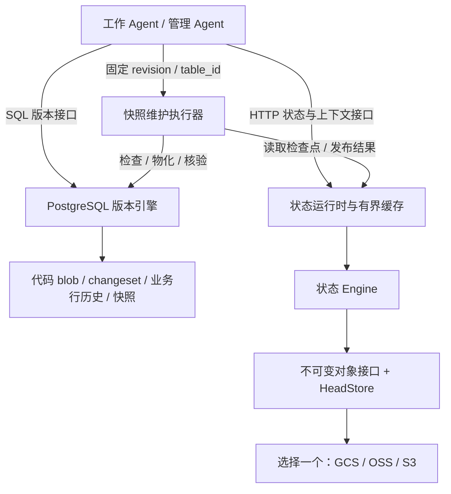

English | [中文](TECHNICAL_BLOG.md)

# Making Agent Work Committable, Branchable and Hand-off-able: The First-Phase Implementation of AgentDB

16 October 2026 · Project phase record; the cloud service status, local review and real GPT experiment additions were revised on 17 October 2026.

> **Cloud services are not verified against real cloud services, and cloud deployment is on hold.** OSS, GCS and S3 have no real cloud integration results, and ECS is not deployed. The cloud storage parts of this article describe the code design and local models, and do not mean anything has run or been successfully verified in the cloud.

One Agent modified the pricing code and at the same time adjusted the prices of a batch of products. Another Agent is experimenting with new stock rules on the same data. The manager Agent has just generated a snapshot for some historical version, and the process was interrupted before it could report the result.

These three scenarios require the system to answer, respectively: can code and data be committed together? Can parallel experiments avoid interfering with each other? Can the Agent taking over tell how far the work has got?

The first phase of AgentDB is organized around these questions: implement joint version management of code and business records in PostgreSQL, and design the storage of management task state, rules and evidence in replaceable cloud object storage; the cloud part has not yet been integration-tested for real. The current target load is a single business table of about 4,000 rows with 10 concurrent Agents.

The version engine has test records on the existing local PostgreSQL; the GCS, Alibaba Cloud OSS and S3 adapters have only code and local tests. The user reports having created a Hangzhou OSS bucket, but the project has not verified its permissions, configuration or real reads/writes. No cloud server purchase or deployment is currently scheduled, and this article does not describe local results as cloud storage having been verified.

## Three findings from two real GPT Agents

On 17 October, we had two real GPT/Codex sub-Agents operate on the same local PostgreSQL test database. The database has 4,000 product rows; both started from the same version and worked on product 101: the price Agent raised the price from 10 to 11, and the stock Agent reduced the stock from 100 to 95; each proposal saved the corresponding Python rule together with the data change. This small experiment made the problems in the interface design concrete.

### The same merge can run into two different conflicts

The price Agent first checked the diff and merged into the main branch. The stock Agent then tried to merge its old proposal, and actually went through the following:

| Stock Agent's action | Database response or final result |
|---|---|
| Merge the old proposal using the common starting point as the expected main branch version | `40001 / stale_head`: the main branch has moved forward |
| Read the latest main branch, then try to merge the same old proposal again | `P0001 / merge_conflict`: whole-row conflict on product 101 |
| Create a recovery branch from the latest main branch and re-commit the stock change | Price stays 11, stock becomes 95, merge succeeded |

The second failure explains why one cannot simply "update the version number and retry". The whole-row state in the old stock proposal is price 10, stock 95, while the main branch is already price 11, stock 100. The current engine compares whole rows, so even though the two Agents modified different fields, a conflict is reported.

After re-reading, the stock Agent re-expressed the intent "reduce stock by 5" from the latest version, checked that the new diff changes only stock, and then completed the merge. Independent database verification confirmed that the final price is **11**, the stock **95**, both pieces of code are kept, the other **3,999 rows** keep their original values, and the pinned baseline has not changed either.

The design feedback from this process is: **a stale version and a content conflict need distinguishable results, and the client needs entry points for re-reading and re-proposing.** The current whole-row comparison increases the coordination cost when different fields are modified; at the same time, the database's rejection rules protected the already merged price change.

### The Agent found that the tools could give a hash, but not the code

While checking the existing proposal, the stock Agent pointed out: `info/diff` can show the path and hash of a newly added file, but cannot return the code text, so it could not confirm before merging whether the `STOCK` constant in the file was correct.

The underlying database already had the ability to read files by version, but the experiment tools did not expose it. Based on this feedback, we added `read-code --revision UUID --path ...`, letting Agents read a specified rule file at a pinned version. The stock Agent then read and confirmed `PRICE = 11.0` and `STOCK = 95` before completing its verification.

What this exposed is a gap in the client contract: **references can locate evidence, but Agents also need an interface to fetch the evidence on demand.** Returning only "the file has been written" or a content hash is not enough to support consistency checks between code and data. This new entry point came from feedback in real use.

### After an interruption, work can continue from the saved proposal

The first attempt was interrupted by the model account's quota limit. At that point the database already had the stock proposal and a price branch with nothing written yet, and the main branch was unchanged. When the experiment continued, the coordinator provided the original task, the baseline and the proposal identifiers, and the GPT taking over confirmed the actual state through pinned-version reads, diffs and code text, continuing from the existing work.

This hand-off shows that the task description and locatable version references can serve as a concrete entry point for recovery. The original stock proposal is still kept by the old branch, and the corrected proposal was committed separately; the final check found no leftover work transactions. What was used here is the version records already in PostgreSQL; recovery from cloud management checkpoints was not verified.

This is a two-Agent experiment with a clear task, limited tools and phased coordination. The coordinator arranged the merge order and hinted to distinguish the two kinds of conflict and to re-propose from the new version; GPT did the actual reading, judging, committing and verifying. The code was only checked for syntax and constants, not executed. The conclusions are limited to this controlled flow; long-term autonomous operation and more models running concurrently remain to be tested. For the detailed process and independent database verification see the [local experiment report](LOCAL_REVIEW_RESULTS.en.md) and the [structured GPT record](../gpt-agent-experiment.json).

## From one observation to a ten-round repeat experiment

To check whether the behavior is stable, we pre-registered and ran **10 rounds** of the same task, each round re-creating two GPT contexts and a 4,000-row test database. The interface explicitly returned the model **`gpt-6-astra`** with reasoning effort **`xhigh`**. This records the exact service model ID; the underlying weight snapshot is not exposed externally; the earlier single round has no model record and cannot be retroactively identified.

| Metric | This observation |
|---|---|
| Completed all three phases / pre-registered rounds | 8 / 10 |
| Achieved the task / pre-registered rounds | 8 / 10 (80%) |
| Tool calls | 261 in total; 31–33 per completed round |
| Reported usage, including partial usage of interrupted rounds | 2,611,119 tokens; cached and reasoning sub-items not added again |
| Ever overwrote the other side's published content / modified the other's branch | 0 rounds / 0 rounds |

Of the 8 completed rounds, all 8 went through the two kinds of conflict, old main branch version and whole-row content, in order. The differences in calls came mainly from reading and verification: info 5–7 times per round, read-code 9–10 times, diff 5–6 times; the write flow always included 3 branch creations, 3 proposals and 4 merge requests, of which 2 merges were rejected by the conflict check. This shows that even when the results are the same, the cost of tool use still varies. The database was checked directly after every write, and the detector was also tested with the counter-example of "overwrite first, restore later", so the overwrite conclusion is not based only on the Agents' own statements or the final state.

In this group, rounds 3 and 4 received the server's `usageLimitExceeded` response; these rounds were not replaced. They did not complete, and cannot be used as evidence that the model would fail to recover from conflicts; the absence of overwrites before the interruption also cannot be used to infer that continuing would certainly have been safe. The error texts, every tool request and response, and per-Agent usage are all saved as raw JSONL, so they can be re-analyzed later without relying on this summary.

This group of experiments is still controlled by the coordinator in the order "stock proposal → price merge → stock recovery", and explicitly hints to try the old version first and re-propose when necessary; it is not ten models writing at the same time, nor autonomous recovery without hints. The overall success rate includes failures of the running service; the 95% Wilson interval under a binomial model is 49.0%–94.3%, and shared account failures and the small sample mean it cannot directly represent production reliability. For per-round results, the counting basis of partial usage and the entry points to the raw evidence see the [repeat experiment report](GPT_REPEAT_EXPERIMENT.en.md). Cloud services are still not verified against real cloud services.

## How the inspiration from Scion maps onto a database

One of the project's starting points is Anthropic's description of Scion: centralize complex version operations on the server, let online clients fetch content on demand, use immutable objects, and treat indexes and snapshots as derivable data. These principles made us start thinking about whether a database interface for Agents should also be organized around pinned versions, parallel experiments and recovery. [The original Scion article](https://www.anthropic.com/engineering/redesigning-source-control)

In this project, this question was turned into testable goals: creating a branch does not copy business tables; the same commit can bind code and data; an Agent does not need to traverse the whole history after restarting; repeated requests and concurrent contention have clear results.

At this stage there is no evidence that PostgreSQL or Spanner cannot handle our load. Directly rewriting the storage engine would not automatically solve branch isolation, context recovery and retries of external operations either. So we first reuse PostgreSQL's transactions and constraints, turn the workflow requirements into concrete data structures and interfaces, and then decide based on measurements whether sharding or replacing the underlying implementation is needed.

"Agent-oriented" here shows up mainly in the client contract: the pinned version is an explicit input, conflicts are structured results, and the basis for hand-off is readable task state. Agents do not need to rely on chat memory to maintain these conventions.

## Two kinds of state, two persistence boundaries

The project manages two different kinds of facts.

| Content | Location in the implementation or design | Main questions |
|---|---|---|
| Code files, business records and their version relationships | PostgreSQL | Whether changes are published atomically, whether branches are isolated, whether merges are valid |
| Management task checkpoints, events, rule versions and evidence | Planned to use the selected cloud object storage; not verified against real cloud services | How tasks are handed off, how commands are deduplicated, how the context stays bounded |
| Recently read tasks and immutable objects | Runtime memory | Reduce repeated reads; can be reloaded after loss |

The code and design structure is as follows; the cloud connections in the diagram have not been verified for real. The object storage adapter is designed so that each deployment selects only one, without automatic cross-cloud dual writes.



(The diagram's labels, in English: work Agent / manager Agent → (SQL version interface) → PostgreSQL version engine; → (HTTP state and context interface) → state runtime and bounded cache; → (pinned revision / table_id) → snapshot maintenance executor. The executor → (read checkpoint / publish result) → the runtime, and → (check / materialize / verify) → the version engine. The version engine → code blobs / changesets / business row history / snapshots. The runtime → state Engine → immutable object interface + HeadStore → pick one: GCS / OSS / S3.)

This diagram also marks an important boundary: **inside PostgreSQL, atomic commits of code and business data are possible; between PostgreSQL and cloud object storage there is no common transaction.** Recovery of management tasks must take into account the case where "the database has already succeeded, but the status report has not yet been published".

The version logic is currently implemented mainly in SQL / PL/pgSQL, and the management state service uses Python. `vc` is the schema name in PostgreSQL; a branch "pointer" is a commit ID stored in a table, and does not mean the project has separately implemented a C++ pointer library.

## One changeset records both code and data

Suppose product 1 has a price of 100, and an Agent wants to change the price to 90 and commit the corresponding pricing code. We want this experiment to have one common version ID, so that the complete result it produces can be compared, merged or read.

The main objects in the version model are:

| Object | Responsibility |
|---|---|
| `vc.changeset`, `vc.parent` | Commit identity and ordered parent-commit relationships |
| `vc.branch` | Branch name, current commit and creation baseline |
| `vc.blob`, `vc.path_change` | Files stored by content hash, and file changes relative to the parent version |
| `vc.row_change` | Row before / after recorded by logical table ID and primary key |
| `vc.work_tx`, `vc.pending_*` | Changes of the current transaction not yet sealed |
| `vc.snapshot_*` | Derived snapshots for a given commit and business table |

Immutability needs a clear moment at which it takes hold. If only updates to history were forbidden, while new file or row changes could keep being inserted into an old changeset, the old version would still change.

So writes first go into the current transaction's staging area, and then `finish_change()` writes the complete history and moves the branch head. This still happens inside the SQL transaction; other connections see the new version only after the actual `COMMIT`. When the sealing operation is omitted, a deferred constraint trigger rejects the commit, and any changes already made to ordinary tables are rolled back too. [Version engine implementation](../sql/001_core.sql)

Below is an example using the existing API. It assumes a test database with the demo structure installed, where main already has product 1 and the branch name is not yet in use; these statements use psql's variable syntax.

```sql
SELECT vc.head('main') AS base_revision \gset
SELECT vc.fork('pricing-experiment', :'base_revision');

BEGIN;
SELECT vc.begin_change(
  'pricing-experiment', :'base_revision',
  'pricing-agent', 'adjust price and pricing code'
);
UPDATE agent.products SET price = 90 WHERE id = 1;
SELECT vc.write_file(
  'src/pricing.py', convert_to('DISCOUNT = 10', 'UTF8')
);
SELECT vc.finish_change() AS proposed_revision \gset
COMMIT;
```

Here `agent.products` is the branch view, and writes are turned into staged changes by an `INSTEAD OF` trigger. The ordinary table that really represents main is `app.products`. Modifying the price on the experiment branch does not change main directly.

Multiple modifications of one row within the same transaction keep only the first before and the last after. An insert immediately followed by a delete cancels out, and a primary key change appears as a delete of the old key and an insert of the new key. This way, a changeset describes the final effective change, avoiding permanently saving every trigger call as a separate version.

Creating a branch only adds a version pointer and does not copy business rows or file contents. It still has index and transaction overhead, though; "not copying the whole table" cannot be interpreted as latency never changing with system load.

### Pinned-version reads and merging

A branch's baseline must be frozen. If it were implemented as "branch overlay plus live main", later changes on main would quietly flow into old branches, and experiment results could not be reproduced.

Reads currently resolve state by commit ID. Row state is replayed along the first-parent chain; finding the common ancestor uses all parent edges. A merge commit can have two parent commits, but the changes it records are relative to the first parent commit, so the two traversal rules must not be mixed.

Read acceleration uses snapshots located by `(changeset, table_id)`. When materializing, the snapshot rows and the completion marker become visible in the same transaction. Snapshots can be rebuilt, and creating one still writes out that table's rows at that version, so what is implemented here is a logical overlay layer, not storage-page-level copy-on-write.

When the experiment is done, the diff can be compared and a merge into main attempted:

```sql
SELECT * FROM vc.diff_files(:'base_revision', :'proposed_revision');
SELECT * FROM vc.diff_rows(
  :'base_revision', :'proposed_revision', vc.table_id('app.products')
);

BEGIN;
SELECT vc.merge('main', :'proposed_revision', :'base_revision', 'pricing-agent');
COMMIT;
```

The merge checks the base, the target version and the source version, currently at whole-row, whole-file granularity. When the same record is changed to different results on the two sides, a conflict is reported; field-level automatic merging is not yet implemented. When merging into main, ordinary-table DML is also executed and PostgreSQL native constraints checked. A file conflict, a unique key conflict or a foreign key failure should all roll back the whole merge.

Concurrency control also has a clear scope: different branches lock their own branch records separately, and publishing on the same main branch head is still serialized. A stale `expected_head` is rejected. Putting code and data in the same database guarantees that these database objects are published together; it does not automatically deploy the code to external processes, let alone bring external actions such as email or payments into the same transaction. [Design notes](../DESIGN_REVIEW.en.md)

## Where does an Agent continue after losing its context

Version management answers "what the data is"; management tasks also need to answer "what to do now". Even if the Agent's service runs all day, context may be lost between model calls, and processes and networks may also be interrupted.

If every recovery read the complete operation log, the read volume and context length would grow with the task's lifetime. Moving the log to another storage location would not solve this on its own. So management state uses a structure in which a small entry point points to the current complete checkpoint:

```text
task head
  ├── state_ref     → 当前完整状态
  ├── event_ref     → 最新事件 → 更早事件 → …
  └── commands_ref  → 已发布命令的去重索引

当前状态
  ├── goal / status / next_action
  ├── uncertainties / facts
  ├── policy_ref
  └── evidence_refs
```

(In the structure above: `state_ref` → the current complete state; `event_ref` → the latest event → earlier events → …; `commands_ref` → the deduplication index of published commands. "当前状态" is "current state", which holds the listed fields.)

The state object limit is **32 KiB**. Each publish saves a complete but bounded checkpoint, so reading the current state needs only two logical objects, the head and the state. The event chain is kept for auditing and is read page by page only when history is explicitly requested.

Detailed reports and rule texts are referenced by content hash; a single evidence object is currently limited to 1 MiB and must be split when larger. Large tasks also need to be split; the size limit cannot be met by deleting unresolved facts.

This design separates three growth costs:

- History storage keeps growing and needs a future retention and reclamation policy.
- Ordinary recovery reads only the current checkpoint and does not scan history in proportion to the number of events.
- What goes into the model is separately constrained by the context budget, with additional reads by reference when necessary.

The context API's default limit is **8,192 UTF-8 bytes**. This is not 8,192 tokens; an exact token budget requires configuring a specific tokenizer. Required fields such as the goal, next step and open items are kept, and when optional facts and evidence exceed the budget, the omitted counts and references are returned. If the required content alone already exceeds the budget, an explicit error is raised.

The runtime uses an in-memory cache limited by both number of entries and bytes. Important operations can request `fresh=true`; notifications only invalidate the cache, followed by a re-read from the authoritative state. The "two logical reads" of cold recovery do not include the cost of subsequently downloading rules and evidence on demand, nor do they mean that the whole Agent hand-off involves only two network requests. [State implementation](../agent_state/engine.py), [context and cache implementation](../agent_state/runtime.py)

## Publishing order and idempotency: still able to tell the result after a lost response

Object storage does not provide a cross-object transaction for the group of objects here. So the publishing flow first prepares the immutable content and updates the task entry point last:

```text
校验请求和新增证据引用
  → 写状态对象
  → 写事件对象
  → 写命令索引的新节点
  → 条件发布 head
```

(The steps are: validate the request and newly added evidence references → write the state object → write the event object → write the new nodes of the command index → conditionally publish the head.)

The last step is the publishing point for a single task. If interrupted after the earlier writes but before the head is published, readers still read from the old entry point; the objects written earlier may become orphans, to be handled by a future GC. Once the head is published successfully, the objects it references already exist.

The client provides `command_id` and the `expected_version` it read. If two writers both modify the state based on version 7, only one is allowed to advance the entry point to version 8, and the other gets a conflict and re-evaluates its intent.

There is a harder case: the server has already published version 8, but the response is lost on the network. When the caller retries, even if the task has since reached version 9, it should be able to recognize that the original command has already completed.

So the system does not save only "the last command ID". It saves historical command receipts in a content-addressed, copy-on-write hash tree, and the head saves only the index root. Lookups locate entries by the hash path of the command ID instead of scanning the event chain entry by entry; a new commit rewrites only the affected index nodes. [Object and command index implementation](../agent_state/objects.py)

The retry rule is: the same ID with the same request returns the original result; the same ID with a different request is rejected. The request fingerprint includes the actor, the state, the expected version and the event description, so when the network result is unclear, the whole request should be retried as is. Casually bumping the expected version already changes the meaning of the request.

Immutable objects do not mean nothing is modified in memory, or that there are no disk writes underneath. What they constrain is the logical content of published objects. The changeset here is also an application-level version record and cannot be equated with the WAL PostgreSQL itself uses for persistence and recovery. The current project likewise does not implement Scion's compression format or storage layout.

## Adapting to OSS: the same publishing semantics need different underlying operations

So that deployers can choose a domestic (China) cloud service, we made Alibaba Cloud OSS the domestic adaptation target, while keeping GCS and S3. The key to the adaptation is verifying whether the underlying operations can satisfy the conditional publishing semantics.

| Backend | How the current adapter publishes the task entry point |
|---|---|
| GCS | Conditional write by generation; creation uses a precondition of generation 0 |
| S3 | Creation uses `If-None-Match: *`, updates use `If-Match: ETag` |
| OSS | Append one fixed-length record at a specified position of an Appendable object |

The write conditions for GCS and S3 follow their respective official interfaces; custom S3-compatible endpoints still need separate verification, and their semantics cannot be assumed identical just from the compatibility label. [GCS request preconditions](https://docs.cloud.google.com/storage/docs/request-preconditions), [S3 conditional writes](https://docs.aws.amazon.com/AmazonS3/latest/userguide/conditional-writes.html)

OSS's `PutObject` does not support the `If-Match` / `If-None-Match` conditional parameters, so the same overwrite logic cannot be applied directly. [OSS conditional parameter limits](https://help.aliyun.com/zh/oss/user-guide/0017-00000245)

The alternative basis we adopted is `AppendObject`: the `position` in the request must match the object's current length, otherwise a position conflict is returned. The fixed record format and read flow below are this project's protocol built on that interface; what currently passes is verification against a local protocol model. [OSS AppendObject](https://help.aliyun.com/zh/oss/developer-reference/appendobject)

### Fixed 8 KiB records, competing by position

Each task uses one `head.json.append-v1` object. Each record is a fixed 8,192 bytes, containing a format identifier, the payload length, a SHA-256 checksum, at most 4,096 bytes of head JSON, and zero padding.

Suppose the file is currently 16,384 bytes long and two writers both ask to append at this position. After the first succeeds, the length becomes 24,576; the second carries the old position and fails because the position does not match. This gives the upper layer the ability to "publish only if the entry point is still the version I read".

After a condition conflict, the adapter must not automatically switch to the latest end and append again. That would let a change based on old state bypass the contention check. Recovery must go back to Engine, check the original command receipt or re-evaluate the business intent.

When reading the current entry point, the length is obtained first, then the last 8 KiB record is read with a range request. If another append happens between the two requests, the record originally selected is still complete and valid, and the version it corresponds to can be returned; later writes are still judged stale or not by the position condition. The implementation also checks the type, length alignment, returned range and checksum, and rejects the read directly on anomalies. [OSS adapter implementation](../agent_state/oss.py)

This brings a fixed extra space cost, and also a clear lifetime limit: the first version limits each task's append file to **4 GiB, i.e. 524,288 publishes**. Reaching the limit rejects new publishes and keeps the old state; there is no transparent rotation yet; longer workflows need to explicitly create a successor task. This limit counts only entry-point records; state, event and index objects take additional space.

Bucket configuration is likewise a protocol precondition. Immutable ordinary objects use a no-overwrite creation method, but when versioning is enabled or suspended, OSS does not prevent same-name overwrites based on that request header, so the current adapter requires that versioning has never been enabled and rejects unsupported retention policy configurations. During operation, the active entry point must also not be deleted or replaced, nor task IDs reused. [OSS PutObject](https://help.aliyun.com/zh/oss/developer-reference/putobject), [this project's storage protocol](STORAGE_BACKENDS.en.md)

To isolate these differences, Engine depends on a separate `HeadStore`, which only deals with reads and conditional publishing. The generation, ETag or append position returned by storage are all used as opaque markers; the cache's newer/older ordering is based on the application-level `version`, without trying to compare which of two ETags is "larger".

## How the superuser Agent maintains the system and hands off

The manager Agent can hold PostgreSQL superuser capabilities and is responsible for maintaining the database structure, version rules and derived data. AGENTS.md and CLAUDE.md describe the operating conventions, and database accounts and cloud identities provide the actual permissions; the rule text itself grants no permissions.

High privileges let an Agent change the system, and also make "how a maintenance action is taken over" a necessary part of the design. We define the flow as: first publish the goal and the verification method, check the real system, perform the operation, then verify and publish the result. The rule text adopted can be stored as evidence, with its version pinned through `policy_ref`.

The maintenance executor currently implemented is pinned-version snapshot materialization. It targets a `revision` and a logical `table_id`, calls `vc.materialize()`, and checks through `vc.snapshot_status()` whether a completion record exists. The SQL layer uses transaction locks to coordinate materialization of the same target, and the completion record and snapshot rows are committed in the same transaction. Routine maintenance adds the restricted role `agentdb_manager`, which does not replace the administrator who changes system rules; old installations first apply the `db.py install-manager` migration. [Snapshot maintenance executor](../agent_state/maintenance.py)

The local experiment checked the following failure window with the real WSL PostgreSQL and the in-memory OSS model, without connecting to a real OSS:

1. Agent A publishes the maintenance intent.
2. PostgreSQL completes the snapshot materialization and commits.
3. Before the task's completed state is published, an interruption is injected.
4. The runtime is rebuilt, and Agent B reads the task checkpoint and checks PostgreSQL.
5. Agent B finds that the snapshot already exists and publishes the verification result, without materializing again.

`verified=true` in the hand-off result only means the local PostgreSQL snapshot has been verified, and `applied=false` means this hand-off did not perform materialization again; neither means cloud storage verification succeeded. [Local hand-off experiment record](../cloud-postgres-oss-protocol.json)

The conditions under which this mechanism applies are very specific: the executor must be able to execute idempotently, or reliably probe for an existing result. Conditional publishing of task state does not automatically guarantee that an arbitrary external action is executed only once. New executors for DDL, deployments or service restarts each need to define their own verification, exclusivity and recovery methods; the current project does not yet provide a general autonomous operations executor.

## Local experiments and the unverified cloud boundary

The existing results come from the local PostgreSQL, in-memory service models, SDK test doubles and loopback HTTP. There are no test results from real cloud storage.

| Local experiment | Recorded result | Scope of interpretation |
|---|---|---|
| Real PostgreSQL | 18 integration tests passed | Using the existing Ubuntu WSL PostgreSQL 16.15 |
| 4,000 rows, 10 concurrent connections | 10 separate branches succeeded; competing on the same old main head, 1 succeeded and 9 got stale-version errors | Synthetic concurrent connections simulating Agent writes, not including model reasoning |
| Database hand-off | Verified successfully after the interruption, without repeated materialization | Real PostgreSQL plus the in-memory OSS protocol model |

The database results are in the [local validation record](../VALIDATION.en.md) and the [raw test report](../test-results-local.json). The local environment and scope of the state adapters are in the [local test notes](STORAGE_BACKENDS_VALIDATION.en.md), which contain no records of cloud success.

The history growth experiment also ran only on the in-memory OSS model; its read counts are not real OSS traffic or performance measurements. It is not listed here as a cloud storage verification result, and the raw local data is kept in the [model experiment record](../oss-protocol-benchmark.json). Real consistency, durability, latency, throughput, capacity and cost are all not verified.

The early PostgreSQL concurrency experiment in the table above is used only for current functional conclusions; its internal timing does not include the final COMMIT and cannot be used to advertise durable commit latency; this project has not done a same-conditions performance comparison with Spanner or other versioned databases.

The supplementary review on 17 October fixed the problem of a stale maintainer swallowing the publishing conflict after another executor had completed, and added a hand-off test for when the intent has been recorded but the database has not yet executed. The two interruption windows, the stale-executor conflict and the restricted management permissions have all been checked on the real local PostgreSQL; the state is still the in-memory model. The full local state suite has 53 items, and the original PostgreSQL assertions are 18.

On the same day an experiment of "all ten branches finally merged" was added: 100 of 4,000 rows changed, ten code files kept, about 14.9 seconds end to end, including client overhead, 45 stale-head retries and the final COMMIT. This is a single contention experiment with ten scripted writers; the 14.9 seconds is the timing of this group of database operations, not the collaboration time of the two GPT Agents described earlier. [Local review and GPT experiment record](LOCAL_REVIEW_RESULTS.en.md)

## Engineering problems to solve next

The current implementation gives branching, joint commits and bounded recovery a runnable behavioral model, but several pieces still need to be filled in before long-term operation.

Cloud integration testing and resident deployment are currently on hold; `smoke_cloud.py` and the deployment draft are kept only for future use. Local development and simulated testing continue for now, and buying servers is not a precondition for continuing the project.

Version queries can continue to be optimized locally. Some current reads still depend on ancestor replay, row merges repeatedly resolve the target state, and file merges enumerate recorded paths; one cannot claim that the cost of every operation depends only on the amount changed just because a changeset stores only changes. Point lookups, predicate pushdown, batched state resolution and long-history loads should be the next group of things to measure.

Long-term retention needs a clear lifecycle protocol: which versions must be kept, which snapshots can be rebuilt, how orphan objects are identified, how GC is guaranteed not to delete content in concurrent publishing, and how the OSS entry point is rotated safely. Saving the recovery scan does not save the history storage.

Finally, DDL versioning, field-level merging, production HTTP deployment, global task scheduling and more maintenance executors are all not yet done. The current version engine is still single-node PostgreSQL, and main publishing uses a branch lock. Whether a deeper distributed design is needed should be decided by the load and failure modes of these specific paths.

What the next phase of AgentDB will continue to verify is: with longer histories, more tasks and more complex failures, Agents can still commit work with explicit versions, understand the current state with a limited context, and hand tasks over to the next executor through verifiable results.
