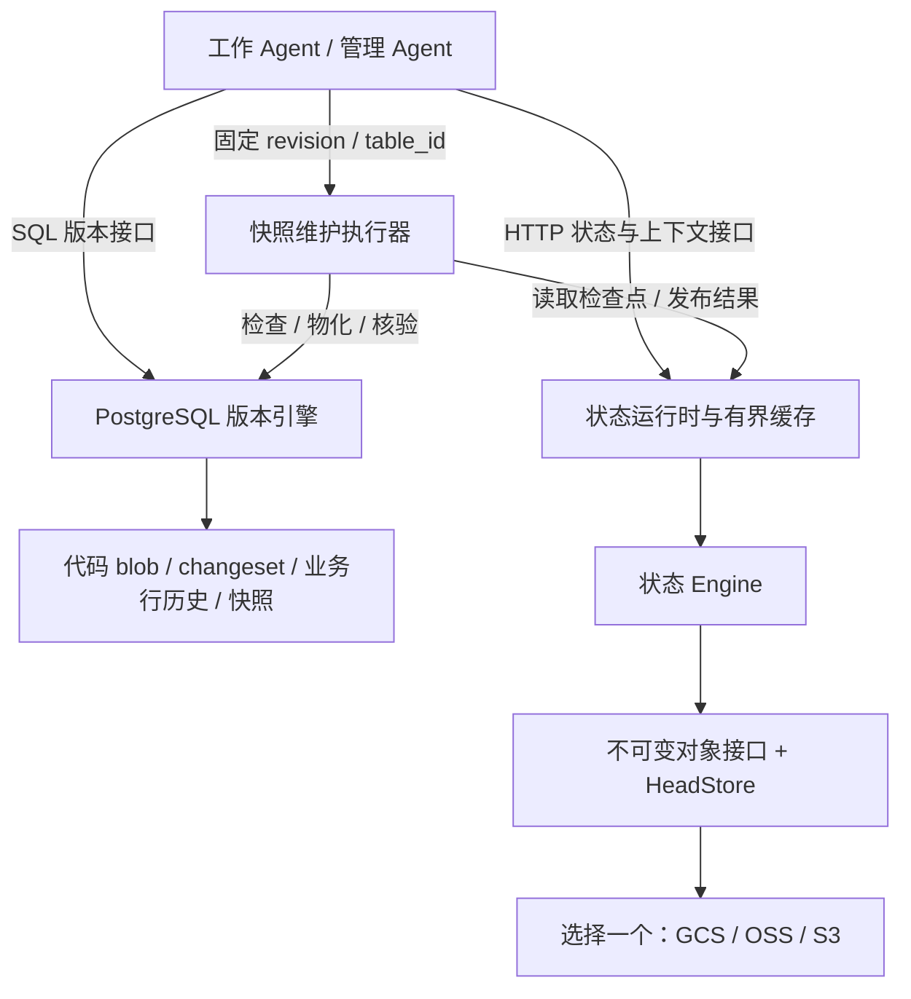

中文 | [English](#english-version)

# 让 Agent 的工作可以提交、分支和接手：Forkpoint 的第一阶段实现

> 注（2026-10-30）：云存储（GCS、OSS、S3）、HTTP 状态服务与 ECS 部署已移除，代码和专门文档留在 git 历史中（最后存在于提交 `d342ccf`）；状态引擎只保留内存后端。下文按当时情况保留，其中提到的这些文件已不存在。

2026 年 10 月 16 日 · 项目阶段记录；云服务状态、本机审查与真实 GPT 实验补充于 2026 年 10 月 17 日修订。

> **云服务未经真实验证，云端部署暂缓。** OSS、GCS、S3 均没有真实云端联调结果，ECS 未部署。本文的云存储部分描述代码设计与本地模型，不代表已经在云端运行或验证成功。

一个 Agent 修改了定价代码，同时调整了一批商品价格。另一个 Agent 正在同一份数据上实验新的库存规则。管理 Agent 刚刚为某个历史版本生成快照，还没来得及报告结果，进程就中断了。

这三个场景分别要求系统回答：代码和数据能否一起提交？并行实验能否互不干扰？接手的 Agent 能否判断已经做到了哪一步？

Forkpoint 的第一阶段围绕这些问题展开：在 PostgreSQL 中实现代码与业务记录的联合版本管理，并设计用可替换的云对象存储保存管理任务的状态、规则和证据；云端部分尚未真实联调。当前目标负载是单张业务表约 4,000 行、10 个并发 Agent。

版本引擎有现有本机 PostgreSQL 的测试记录；GCS、阿里云 OSS 和 S3 适配器只具备代码与本地测试。用户报告已创建杭州 OSS 桶，但项目未核验其权限、配置和真实读写。当前不安排云服务器采购或部署，本文不将本地结果表述为云存储已验证。

## 两个真实 GPT Agent 带来的三个发现

10 月 17 日，我们让两个真实 GPT/Codex 子 Agent 操作同一个本机 PostgreSQL 测试库。库中有 4,000 行商品，两者从相同版本出发，处理商品 101：价格 Agent 将价格从 10 提高到 11，库存 Agent 将库存从 100 减少到 95；每个提案同时保存对应的 Python 规则和数据修改。这次小实验让接口设计中的问题变得具体。

### 同一次合入，可能遇到两种不同的冲突

价格 Agent 先核对差异并合入主分支。库存 Agent 随后尝试合入旧提案，实际经历了下面的过程：

| 库存 Agent 的操作 | 数据库返回或最终结果 |
|---|---|
| 用共同起点作为预期主分支版本，合入旧提案 | `40001 / stale_head`：主分支已经前进 |
| 读取最新主分支，再尝试合入同一个旧提案 | `P0001 / merge_conflict`：商品 101 存在整行冲突 |
| 从最新主分支建立恢复分支，重新提交库存修改 | 价格保持 11，库存变为 95，合入成功 |

第二次失败解释了为什么不能简单地“更新版本号，再重试”。旧库存提案中的整行状态是价格 10、库存 95，而主分支已经是价格 11、库存 100。当前引擎按整行比较，即使两个 Agent 修改的是不同字段，也会报告冲突。

库存 Agent 在重读后，从最新版本重新表达“库存减少 5”这个意图，核对新差异只改库存，再完成合入。数据库独立核验确认最终价格为 **11**、库存为 **95**，两份代码都保留，其余 **3,999 行**保持原值，固定基线也没有改变。

这个过程给出的设计反馈是：**版本过期与内容冲突需要可区分的结果，客户端需要重读和重新提案的入口。** 当前整行比较增加了不同字段修改时的协调成本；同时，数据库端的拒绝规则保护了已经合入的价格修改。

### Agent 发现工具只能给出哈希，却不能给出代码

库存 Agent 在检查已有提案时指出：`info/diff` 能显示新增文件的路径和哈希，却无法返回代码正文，因此它无法在合入前确认文件里的 `STOCK` 常量是否正确。

底层数据库已有按版本读取文件的能力，实验工具尚未暴露这一能力。根据这条反馈，我们补上 `read-code --revision UUID --path ...`，让 Agent 按固定版本读取指定规则文件。库存 Agent 随后读取并确认 `PRICE = 11.0` 和 `STOCK = 95`，再完成核验。

这暴露的是客户端契约的缺口：**引用能定位证据，Agent 还需要一个按需取回证据的接口。** 只返回“文件已经写入”或内容哈希，不足以支持代码与数据的一致性检查。这个新增入口来自真实使用中的反馈。

### 中断之后，可以从已保存的提案继续

首次尝试因模型账户额度限制中断。当时数据库中已有库存提案和一个尚未写入的价格分支，主分支未改变。继续实验时，协调者提供原任务、基线和提案标识，接手的 GPT 再通过固定版本读取、差异和代码正文确认实际状态，从已有工作继续。

这次接手表明，任务说明与可定位的版本引用能成为恢复的具体入口。原库存提案仍由旧分支保留，修正后的提案另行提交；最终检查没有发现遗留工作事务。这里使用的是 PostgreSQL 中已有的版本记录，没有验证云端管理检查点的恢复。

这是一项有明确任务、有限工具和分阶段协调的两 Agent 实验。协调者安排了合入顺序，并提示区分两类冲突及从新版本重新提案；GPT 负责实际读取、判断、提交和核验。代码只检查语法与常量，未执行。结论限于这次受控流程，长期自主运行和更多模型并发仍待测试。详细过程及独立数据库核验见[本机实验报告](LOCAL_REVIEW_RESULTS.md)与[结构化 GPT 记录](../results/gpt-agent-experiment.json)。

## 从一次观察到十轮重复实验

为检验行为是否稳定，我们预先登记并执行了 **10 轮**相同任务，每轮重新创建两个 GPT 上下文和一个 4,000 行测试库。接口明确返回模型 **`gpt-6-astra`**、推理强度 **`xhigh`**。这记录了精确的服务模型 ID，底层权重快照没有对外暴露；此前单轮没有型号记录，不能事后补认。

| 指标 | 本次观察 |
|---|---|
| 完成全部三阶段 / 预登记轮次 | 8 / 10 |
| 达成任务 / 预登记轮次 | 8 / 10（80%） |
| 工具调用 | 共 261 次；完成轮次每轮 31–33 次 |
| 已报告用量，含中断轮次的部分用量 | 2,611,119 tokens；缓存和推理子项不重复相加 |
| 曾覆盖另一方已发布内容 / 修改对方分支 | 0 轮 / 0 轮 |

完成的 8 轮中，8 轮依次经历了旧主分支版本和整行内容两类冲突。调用差异主要来自读取与核验：info 每轮 5–7 次，read-code 9–10 次，diff 5–6 次；写入流程则都包含 3 次建分支、3 次提案和 4 次合入请求，其中 2 次合入被冲突检查拒绝。这说明即使结果一致，工具使用成本仍会变化。每次写入后都直接核查数据库，检测器还用“先覆盖、后来恢复”的反例检验过，覆盖结论并非只根据 Agent 自述或最终状态得出。

本组中第 3、4 轮收到服务端 `usageLimitExceeded` 返回；这些轮次没有被替换。它们未完成，不能作为模型不会恢复冲突的证据；中断前未覆盖也不能推断继续执行一定安全。错误原文、每次工具请求和响应、逐 Agent 用量均保存为原始 JSONL，后续可以重新分析，而不必依赖这篇摘要。

这组实验仍然由协调器控制“库存提案→价格合入→库存恢复”的顺序，并明确提示先尝试旧版本、必要时重新提案；不是十个模型同时写入，也不是没有提示的自主恢复。总体成功率包含运行服务失败；二项模型下的 95% Wilson 区间为 49.0%–94.3%，共享账户故障与小样本使它不能直接代表生产可靠性。逐轮结果、部分用量口径和原始证据入口见[重复实验报告](GPT_REPEAT_EXPERIMENT.md)。云服务仍未经真实验证。

## 从 Scion 得到的启发，如何落到数据库上

项目的出发点之一，是 Anthropic 对 Scion 的介绍：把复杂版本操作集中到服务端，让在线客户端按需获取内容，使用不可变对象，并把索引和快照作为可派生的数据。这些原则使我们开始思考，Agent 的数据库接口是否也应该围绕固定版本、并行实验和恢复来组织。[Scion 原文](https://www.anthropic.com/engineering/redesigning-source-control)

在本项目中，这个问题被转换成了可以检验的目标：创建分支时不复制业务表；同一提交能够绑定代码与数据；Agent 重启后不必遍历全部历史；重复请求和并发竞争具有明确结果。

现阶段没有证据表明 PostgreSQL 或 Spanner 无法满足我们的负载。直接重写存储引擎，也无法自动解决分支隔离、上下文恢复和外部操作重试。因此我们先复用 PostgreSQL 的事务与约束，将工作流要求落实为具体的数据结构和接口，再根据测量结果决定是否需要分片或更换底层实现。

这里的“面向 Agent”，主要体现在客户端契约上：固定版本是显式输入，冲突是结构化结果，接手依据是可读取的任务状态。Agent 不需要依靠聊天记忆维持这些约定。

## 两类状态，两个持久化边界

项目管理两类不同的事实。

| 内容 | 实现或设计中的位置 | 主要问题 |
|---|---|---|
| 代码文件、业务记录及其版本关系 | PostgreSQL | 修改是否原子发布，分支是否隔离，合并是否有效 |
| 管理任务检查点、事件、规则版本和证据 | 计划使用所选云对象存储；未经真实验证 | 任务如何接手，命令如何去重，上下文如何保持有界 |
| 最近读取的任务与不可变对象 | 运行时内存 | 减少重复读取；丢失后可以重新加载 |

代码与设计结构如下；图中的云端连接尚未真实验证。对象存储适配器的设计是每次部署只选择一个，不做自动跨云双写。



这张图同时标出了一个重要边界：**PostgreSQL 内部可以提供代码与业务数据的原子提交，PostgreSQL 与云对象存储之间没有共同事务。** 管理任务的恢复必须考虑“数据库已经成功，状态报告尚未发布”的情况。

版本逻辑目前主要由 SQL / PL/pgSQL 实现，管理状态服务使用 Python。`vc` 是 PostgreSQL 中的 schema 名称；分支“指针”是表中保存的提交 ID，并不表示项目另外实现了一个 C++ 指针库。

## 一次 changeset，同时记录代码与数据

假设商品 1 的价格是 100，Agent 想把价格改为 90，并提交对应的定价代码。我们希望这个实验有一个共同的版本 ID，以便比较、合并或读取它产生的完整结果。

版本模型中的主要对象如下：

| 对象 | 职责 |
|---|---|
| `vc.changeset`、`vc.parent` | 提交身份及有序父提交关系 |
| `vc.branch` | 分支名称、当前提交和创建基线 |
| `vc.blob`、`vc.path_change` | 按内容哈希保存文件，以及相对父版本的文件变化 |
| `vc.row_change` | 按逻辑表 ID、主键记录行的 before / after |
| `vc.work_tx`、`vc.pending_*` | 当前事务尚未封口的修改 |
| `vc.snapshot_*` | 指定提交和业务表的派生快照 |

不可变性需要一个明确的成立时刻。如果只禁止更新历史，却允许不断向旧 changeset 插入新的文件或行变化，旧版本依然会改变。

因此写入先进入当前事务的暂存区，再由 `finish_change()` 写入完整历史并移动分支头。它仍处于 SQL 事务内部；其他连接看到新版本，要等到真正的 `COMMIT`。遗漏封口操作时，延迟约束触发器会拒绝提交，已经发生的普通表修改也一起回滚。[版本引擎实现](../sql/001_core.sql)

下面是使用现有 API 的示例。前提是在已安装演示结构的测试库中，main 已有商品 1，且分支名尚未使用；这些语句采用 psql 的变量语法。

```sql
SELECT vc.head('main') AS base_revision \gset
SELECT vc.fork('pricing-experiment', :'base_revision');

BEGIN;
SELECT vc.begin_change(
  'pricing-experiment', :'base_revision',
  'pricing-agent', 'adjust price and pricing code'
);
UPDATE agent.products SET price = 90 WHERE id = 1;
SELECT vc.write_file(
  'src/pricing.py', convert_to('DISCOUNT = 10', 'UTF8')
);
SELECT vc.finish_change() AS proposed_revision \gset
COMMIT;
```

这里的 `agent.products` 是分支视图，写入由 `INSTEAD OF` 触发器转成暂存变化。真正代表 main 的普通表是 `app.products`。在实验分支上修改价格，不会直接改变 main。

同一事务内对一行多次修改，只保留第一次 before 和最后一次 after。插入后立即删除可以抵消，主键变化则表现为旧键删除和新键插入。这样，一个 changeset 描述的是最终有效变化，避免把每次触发器调用都永久保存成独立版本。

分支创建只增加版本指针，不复制业务行或文件内容。不过它仍有索引与事务开销；“不复制整表”不能被解释为延迟永远不随系统负载变化。

### 固定版本读取与合并

分支的基线必须冻结。假如实现成“分支覆盖层加上实时 main”，main 后续产生的修改就会悄悄进入旧分支，实验结果无法复现。

当前读取按提交 ID 解析状态。行状态沿第一父链回放；共同祖先查找则使用全部父边。合并提交可以有两个父提交，但它记录的变化相对第一父提交，不能把两套遍历规则混在一起。

读取加速使用 `(changeset, table_id)` 定位的快照。物化时，快照行和完成标记在同一事务中可见。快照能够重建，创建它仍会写出该表在该版本下的行，因此这里实现的是逻辑覆盖层，不是存储页级的写时复制。

当实验完成，可以比较差异并尝试合入 main：

```sql
SELECT * FROM vc.diff_files(:'base_revision', :'proposed_revision');
SELECT * FROM vc.diff_rows(
  :'base_revision', :'proposed_revision', vc.table_id('app.products')
);

BEGIN;
SELECT vc.merge('main', :'proposed_revision', :'base_revision', 'pricing-agent');
COMMIT;
```

合并检查 base、目标版本和来源版本，目前采用整行、整文件粒度。相同记录被两侧改成不同结果，会报告冲突；尚未实现字段级自动合并。合入 main 时，还要执行普通表 DML 并检查 PostgreSQL 原生约束。文件冲突、唯一键冲突或外键失败，都应使整次合入回滚。

并发控制也有明确范围：不同分支分别锁自己的分支记录，同一个 main 分支头上的发布仍然串行。旧的 `expected_head` 会被拒绝。代码与数据放在同一数据库，保证的是这些数据库对象一起发布；它不会自动把代码部署到外部进程，更不会让邮件、支付等外部动作加入同一个事务。[设计说明](DESIGN_REVIEW.md)

## Agent 丢失上下文后，从哪里继续

版本管理解决了“数据是什么”，管理任务还需要回答“现在要做什么”。即使 Agent 的服务全天运行，模型调用之间也可能丢失上下文，进程和网络也可能中断。

如果每次恢复都读完整操作日志，读取量和上下文长度就会随着任务寿命增长。将日志换一个存储位置，并不能单独解决这个问题。因此管理状态采用一个小入口指向当前完整检查点的结构：

```text
task head
  ├── state_ref     → 当前完整状态
  ├── event_ref     → 最新事件 → 更早事件 → …
  └── commands_ref  → 已发布命令的去重索引

当前状态
  ├── goal / status / next_action
  ├── uncertainties / facts
  ├── policy_ref
  └── evidence_refs
```

状态对象上限是 **32 KiB**。每次发布都会保存一份完整但有界的检查点，因此读取当前状态只需要 head 和状态两个逻辑对象。事件链保留用于审计，只有显式请求历史时才分页读取。

详细报告和规则文本通过内容哈希引用；单个证据对象当前上限为 1 MiB，超过时需要拆分。大任务也需要拆分，不能通过删掉尚未解决的事实来勉强满足大小限制。

这个设计把三种增长成本分开了：

- 历史存储量继续增长，需要未来的保留与回收策略。
- 普通恢复只读取当前检查点，不随事件条数扫描历史。
- 进入模型的内容另受上下文预算约束，必要时按引用补读。

上下文 API 默认限制为 **8,192 个 UTF-8 字节**。这不是 8,192 tokens；精确 token 预算需要配置具体编码器。目标、下一步、未决事项等必要字段保留，可选事实和证据超预算时返回省略数量与引用。如果必要内容本身已超预算，就明确报错。

运行时使用按条目数和字节数限制的内存缓存。重要操作可以要求 `fresh=true`；通知只让缓存失效，再从权威状态重新读取。冷恢复的“两次逻辑读取”不包含随后按需下载规则和证据的成本，也不等于整个 Agent 接手只会发生两次网络请求。[状态实现](../agent_state/engine.py)、[上下文与缓存实现](../agent_state/runtime.py)

## 发布顺序与幂等：响应丢失之后仍能判断结果

对象存储没有为这里的一组对象提供跨对象事务。发布流程因此先准备不可变内容，最后更新任务入口：

```text
校验请求和新增证据引用
  → 写状态对象
  → 写事件对象
  → 写命令索引的新节点
  → 条件发布 head
```

最后一步是单个任务的发布点。前面写完、head 尚未发布时中断，读者仍从旧入口读取；先写出的对象可能成为孤儿，需要未来的 GC 处理。head 成功发布后，其引用的对象已经存在。

客户端提供 `command_id` 和读取到的 `expected_version`。两个写者都基于版本 7 修改状态，只允许一个把入口推进到版本 8，另一个获得冲突并重新判断意图。

还有一种更难处理的情况：服务端已经发布版本 8，但响应在网络上丢失。调用方重试时，即使任务后来又到了版本 9，也应该能认出当初那条命令已经完成。

所以系统没有只保存“最后一个命令 ID”。它用内容寻址、写时复制的哈希树保存历史命令回执，head 只保存索引根。查询按命令 ID 的哈希路径定位，不逐条扫描事件链；新提交只重写受影响的索引节点。[对象与命令索引实现](../agent_state/objects.py)

重试规则是：相同 ID、相同请求返回原结果；相同 ID、不同请求则拒绝。请求指纹包含 actor、状态、预期版本和事件描述，所以网络结果不明时，应保留整条请求重试。随手把预期版本改大，已经改变了请求含义。

不可变对象并不意味着内存没有修改，或底层没有磁盘写入。它约束的是已发布对象的逻辑内容。这里的 changeset 也是应用层版本记录，不能等同于 PostgreSQL 自身用于持久化与恢复的 WAL。当前项目同样没有实现 Scion 那套压缩格式或存储布局。

## 适配 OSS：同样的发布语义，需要不同的底层操作

为了让部署者可以选择国内云服务，我们将阿里云 OSS 作为国内适配目标，同时保留 GCS 和 S3。适配的关键是验证底层操作能否满足条件发布语义。

| 后端 | 当前适配器的任务入口发布方式 |
|---|---|
| GCS | 按 generation 条件写入；创建使用 generation 为 0 的前置条件 |
| S3 | 创建使用 `If-None-Match: *`，更新使用 `If-Match: ETag` |
| OSS | 向 Appendable 对象的指定位置追加一条固定长度记录 |

GCS 与 S3 的写入条件分别依据其官方接口；自定义 S3 兼容端点仍需要单独验证，不能仅凭兼容名称就认定语义一致。[GCS 请求前置条件](https://docs.cloud.google.com/storage/docs/request-preconditions)、[S3 条件写入](https://docs.aws.amazon.com/AmazonS3/latest/userguide/conditional-writes.html)

OSS 的 `PutObject` 不支持 `If-Match` / `If-None-Match` 这组条件参数，因此不能直接套用同一套覆盖逻辑。[OSS 条件参数限制](https://help.aliyun.com/zh/oss/user-guide/0017-00000245)

我们采用的替代基础是 `AppendObject`：请求中的 `position` 必须与对象当前长度匹配，否则返回位置冲突。下面的固定记录格式和读取流程是本项目建立在该接口上的协议，当前通过的是本地协议模型验证。[OSS AppendObject](https://help.aliyun.com/zh/oss/developer-reference/appendobject)

### 固定 8 KiB 记录，按位置竞争

每个任务使用一个 `head.json.append-v1` 对象。每条记录固定为 8,192 字节，包含格式标识、有效载荷长度、SHA-256 校验、最多 4,096 字节的 head JSON，以及零填充。

假设当前文件长 16,384 字节，两个写者都要求从这个位置追加。第一个成功后，长度变成 24,576；第二个携带旧位置，就会因位置不匹配而失败。这为上层提供了“仅当入口仍是我读到的版本时才发布”的能力。

条件冲突后，适配器不能自动改用最新末尾再追加。那会让本来基于旧状态的修改绕过竞争检查。恢复必须回到 Engine，检查原命令回执或重新判断业务意图。

读取当前入口时，先取得长度，再通过范围请求读取最后一条 8 KiB 记录。若两次请求之间又发生追加，原先选定的记录仍然完整有效，返回它对应的版本即可；后续写入仍由位置条件判断是否过时。实现还检查类型、长度对齐、返回范围和校验值，异常时直接拒绝读取。OSS 适配器实现

这带来了固定的额外空间成本，也有明确的寿命上限：首版把每个任务的追加文件限制为 **4 GiB，也就是 524,288 次发布**。达到上限会拒绝新发布并保留旧状态，尚无透明轮转；更长的工作流需要显式建立后继任务。这个上限只计算入口记录，状态、事件和索引对象还会额外占用空间。

桶配置同样属于协议前提。不可变普通对象采用禁止覆盖的创建方式，而 OSS 在开启或暂停版本控制时不会按该请求头禁止同名覆盖，因此当前适配器要求版本控制从未开启，并拒绝不支持的保留策略配置。运行期间也不能删除或替换活跃入口、复用任务 ID。[OSS PutObject](https://help.aliyun.com/zh/oss/developer-reference/putobject)、本项目存储协议

为隔离这些差异，Engine 依赖独立的 `HeadStore`，只关心读取和条件发布。存储返回的 generation、ETag 或追加位置都作为不透明标记使用；缓存的新旧排序依据应用层 `version`，不尝试比较两个 ETag 谁“更大”。

## Superuser Agent 如何维护系统并交接

管理 Agent 可以持有 PostgreSQL superuser 能力，负责维护数据库结构、版本规则和派生数据。AGENTS.md、CLAUDE.md 描述操作约定，数据库账户和云身份提供真实权限；规则文本本身不会授予权限。

高权限让 Agent 能够改变系统，也使“维护动作如何被接手”成为必要设计。我们把流程定义为：先发布目标和核验方法，检查真实系统，执行操作，再核验并发布结果。采用的规则文本可以存为证据，通过 `policy_ref` 固定版本。

当前已经实现的维护执行器是固定版本快照物化。它以 `revision` 和逻辑 `table_id` 为目标，调用 `vc.materialize()`，并通过 `vc.snapshot_status()` 检查是否存在完成记录。SQL 层使用事务锁协调同一目标的物化，完成记录与快照行在同一事务提交。常规维护新增受限角色 `agentdb_manager`，不替代改变系统规则的管理员；旧安装先应用 `db.py install-manager` 迁移。[快照维护执行器](../agent_state/maintenance.py)

本机实验以真实 WSL PostgreSQL 和内存 OSS 模型检查了以下故障窗口，未连接真实 OSS：

1. Agent A 发布维护意图。
2. PostgreSQL 完成快照物化并提交。
3. 在发布任务完成状态之前，注入中断。
4. 重建运行时，由 Agent B 读取任务检查点并核对 PostgreSQL。
5. Agent B 发现快照已经存在，发布核验结果，无需再次物化。

接手结果中的 `verified=true` 只表示本机 PostgreSQL 快照已核验，`applied=false` 表示本次接手没有再次执行物化；二者都不表示云存储验证成功。[本地接手实验记录](../results/cloud-postgres-oss-protocol.json)

这套机制的适用条件很具体：执行器必须能够幂等执行，或者可靠探测既有结果。任务状态的条件发布不会自动保证任意外部动作只执行一次。新的 DDL、部署或服务重启执行器，都需要各自定义核验、排他与恢复方法；当前项目尚未提供一个通用的自主运维执行器。

## 本地实验与未经验证的云端边界

已有结果来自本机 PostgreSQL、内存服务模型、SDK 测试替身和回环 HTTP。没有真实云存储的测试结果。

| 本地实验 | 已记录结果 | 解释范围 |
|---|---|---|
| 真实 PostgreSQL | 18 项集成测试通过 | 使用既有 Ubuntu WSL PostgreSQL 16.15 |
| 4,000 行、10 并发连接 | 独立分支 10 个成功；同一旧 main head 竞争时 1 成功、9 个陈旧版本错误 | 合成并发连接模拟 Agent 写入，不包含模型推理 |
| 数据库接手 | 中断后成功核验，未重复物化 | 真实 PostgreSQL 加内存 OSS 协议模型 |

数据库结果见 [本机验证记录](VALIDATION.md) 与 [原始测试报告](../results/test-results-local.json)。状态适配器的本地环境及范围见 本地测试说明，其中不包含云端成功记录。

历史增长实验也只运行于内存 OSS 模型；其读取计数不属于真实 OSS 流量或性能测量。这里不列作云存储验证结果，原始本地数据保留在 [模型实验记录](../results/oss-protocol-benchmark.json)。真实一致性、持久性、延迟、吞吐、容量和费用均未经验证。

上表早期 PostgreSQL 并发实验只用于当前功能结论，其内部计时不包含最终 COMMIT，不能拿来宣传持久化提交延迟；本项目没有与 Spanner 或其他版本数据库做同条件性能对照。

10 月 17 日的补充审查修复了旧维护者在另一执行者完成后吞掉发布冲突的问题，并增加意图已记录、数据库尚未执行时的接手测试。两个中断窗口、旧执行者冲突和受限管理权限均已在真实本机 PostgreSQL 检查；状态仍为内存模型。完整本地状态套件为 53 项，原有 PostgreSQL 断言为 18 项。

同日新增“十个分支最终全部合入”的实验：4,000 行中修改 100 行，保留十个代码文件，端到端约 14.9 秒，包含客户端开销、45 次陈旧 head 重试和最终 COMMIT。这是十个脚本写入者的一次争用实验；14.9 秒是这一组数据库操作的计时，不是前述两个 GPT Agent 的协作耗时。[本机审查与 GPT 实验记录](LOCAL_REVIEW_RESULTS.md)

## 接下来需要解决的工程问题

当前实现让分支、联合提交和有界恢复具有了可运行的行为模型，但距离长期运行还需要补齐几个环节。

云端联调和常驻部署当前暂缓，`smoke_cloud.py` 与部署草案仅保留供未来使用。当前继续本地开发和模拟测试，不把购买服务器作为继续项目的前提。

本地可以继续优化版本查询。当前一些读取仍依赖祖先回放，行合并会反复解析目标状态，文件合并会枚举已记录路径；不能因为 changeset 只保存变化，就宣称所有操作成本都只取决于变化量。点查、谓词下推、批量状态解析与长历史负载，应成为下一组测量对象。（2026-10-22 补注：此后行合并改为每张表一次批量读取目标状态（迁移 004），历史遍历有了上限、文件合并只检查可能不同的路径，并新增快照策略（005），见 [合入耗时](MERGE_BENCHMARK.md) 与 [历史增长](HISTORY_GROWTH.md)；分支读取仍依赖历史回放加快照。）

长期保存则需要明确的生命周期协议：哪些版本必须保留，哪些快照可以重建，如何识别孤儿对象，如何保证 GC 不删除并发发布中的内容，以及 OSS 入口如何安全轮转。省下恢复扫描，不等于省下历史存储。

最后，DDL 版本化、字段级合并、生产 HTTP 部署、全局任务调度和更多维护执行器都尚未完成。当前版本引擎仍是单节点 PostgreSQL，main 发布使用分支锁。是否需要更深层的分布式设计，应由这些具体路径的负载与失败模式来决定。

Forkpoint 下一阶段要继续验证的是：在历史更长、任务更多、故障更复杂的情况下，Agent 仍能以明确的版本提交工作，以有限的上下文理解当前状态，并通过可核验的结果把任务交给下一个执行者。

---

<a id="english-version"></a>

# Making Agent Work Committable, Branchable and Hand-off-able: The First-Phase Implementation of Forkpoint

> Note (2026-10-30): cloud storage (GCS, OSS, S3), the HTTP state service and the ECS deployment have been removed; the code and their own docs remain in git history (last present in commit `d342ccf`), and the state engine keeps only its in-memory backend. What follows is kept as it was, and the files it names for these no longer exist.

16 October 2026 · Project phase record; the cloud service status, local review and real GPT experiment additions were revised on 17 October 2026.

> **Cloud services are not verified against real cloud services, and cloud deployment is on hold.** OSS, GCS and S3 have no real cloud integration results, and ECS is not deployed. The cloud storage parts of this article describe the code design and local models, and do not mean anything has run or been successfully verified in the cloud.

One Agent modified the pricing code and at the same time adjusted the prices of a batch of products. Another Agent is experimenting with new stock rules on the same data. The manager Agent has just generated a snapshot for some historical version, and the process was interrupted before it could report the result.

These three scenarios require the system to answer, respectively: can code and data be committed together? Can parallel experiments avoid interfering with each other? Can the Agent taking over tell how far the work has got?

The first phase of Forkpoint is organized around these questions: implement joint version management of code and business records in PostgreSQL, and design the storage of management task state, rules and evidence in replaceable cloud object storage; the cloud part has not yet been integration-tested for real. The current target load is a single business table of about 4,000 rows with 10 concurrent Agents.

The version engine has test records on the existing local PostgreSQL; the GCS, Alibaba Cloud OSS and S3 adapters have only code and local tests. The user reports having created a Hangzhou OSS bucket, but the project has not verified its permissions, configuration or real reads/writes. No cloud server purchase or deployment is currently scheduled, and this article does not describe local results as cloud storage having been verified.

## Three findings from two real GPT Agents

On 17 October, we had two real GPT/Codex sub-Agents operate on the same local PostgreSQL test database. The database has 4,000 product rows; both started from the same version and worked on product 101: the price Agent raised the price from 10 to 11, and the stock Agent reduced the stock from 100 to 95; each proposal saved the corresponding Python rule together with the data change. This small experiment made the problems in the interface design concrete.

### The same merge can run into two different conflicts

The price Agent first checked the diff and merged into the main branch. The stock Agent then tried to merge its old proposal, and actually went through the following:

| Stock Agent's action | Database response or final result |
|---|---|
| Merge the old proposal using the common starting point as the expected main branch version | `40001 / stale_head`: the main branch has moved forward |
| Read the latest main branch, then try to merge the same old proposal again | `P0001 / merge_conflict`: whole-row conflict on product 101 |
| Create a recovery branch from the latest main branch and re-commit the stock change | Price stays 11, stock becomes 95, merge succeeded |

The second failure explains why one cannot simply "update the version number and retry". The whole-row state in the old stock proposal is price 10, stock 95, while the main branch is already price 11, stock 100. The current engine compares whole rows, so even though the two Agents modified different fields, a conflict is reported.

After re-reading, the stock Agent re-expressed the intent "reduce stock by 5" from the latest version, checked that the new diff changes only stock, and then completed the merge. Independent database verification confirmed that the final price is **11**, the stock **95**, both pieces of code are kept, the other **3,999 rows** keep their original values, and the pinned baseline has not changed either.

The design feedback from this process is: **a stale version and a content conflict need distinguishable results, and the client needs entry points for re-reading and re-proposing.** The current whole-row comparison increases the coordination cost when different fields are modified; at the same time, the database's rejection rules protected the already merged price change.

### The Agent found that the tools could give a hash, but not the code

While checking the existing proposal, the stock Agent pointed out: `info/diff` can show the path and hash of a newly added file, but cannot return the code text, so it could not confirm before merging whether the `STOCK` constant in the file was correct.

The underlying database already had the ability to read files by version, but the experiment tools did not expose it. Based on this feedback, we added `read-code --revision UUID --path ...`, letting Agents read a specified rule file at a pinned version. The stock Agent then read and confirmed `PRICE = 11.0` and `STOCK = 95` before completing its verification.

What this exposed is a gap in the client contract: **references can locate evidence, but Agents also need an interface to fetch the evidence on demand.** Returning only "the file has been written" or a content hash is not enough to support consistency checks between code and data. This new entry point came from feedback in real use.

### After an interruption, work can continue from the saved proposal

The first attempt was interrupted by the model account's quota limit. At that point the database already had the stock proposal and a price branch with nothing written yet, and the main branch was unchanged. When the experiment continued, the coordinator provided the original task, the baseline and the proposal identifiers, and the GPT taking over confirmed the actual state through pinned-version reads, diffs and code text, continuing from the existing work.

This hand-off shows that the task description and locatable version references can serve as a concrete entry point for recovery. The original stock proposal is still kept by the old branch, and the corrected proposal was committed separately; the final check found no leftover work transactions. What was used here is the version records already in PostgreSQL; recovery from cloud management checkpoints was not verified.

This is a two-Agent experiment with a clear task, limited tools and phased coordination. The coordinator arranged the merge order and hinted to distinguish the two kinds of conflict and to re-propose from the new version; GPT did the actual reading, judging, committing and verifying. The code was only checked for syntax and constants, not executed. The conclusions are limited to this controlled flow; long-term autonomous operation and more models running concurrently remain to be tested. For the detailed process and independent database verification see the [local experiment report](LOCAL_REVIEW_RESULTS.md) and the [structured GPT record](../results/gpt-agent-experiment.json).

## From one observation to a ten-round repeat experiment

To check whether the behavior is stable, we pre-registered and ran **10 rounds** of the same task, each round re-creating two GPT contexts and a 4,000-row test database. The interface explicitly returned the model **`gpt-6-astra`** with reasoning effort **`xhigh`**. This records the exact service model ID; the underlying weight snapshot is not exposed externally; the earlier single round has no model record and cannot be retroactively identified.

| Metric | This observation |
|---|---|
| Completed all three phases / pre-registered rounds | 8 / 10 |
| Achieved the task / pre-registered rounds | 8 / 10 (80%) |
| Tool calls | 261 in total; 31–33 per completed round |
| Reported usage, including partial usage of interrupted rounds | 2,611,119 tokens; cached and reasoning sub-items not added again |
| Ever overwrote the other side's published content / modified the other's branch | 0 rounds / 0 rounds |

Of the 8 completed rounds, all 8 went through the two kinds of conflict, old main branch version and whole-row content, in order. The differences in calls came mainly from reading and verification: info 5–7 times per round, read-code 9–10 times, diff 5–6 times; the write flow always included 3 branch creations, 3 proposals and 4 merge requests, of which 2 merges were rejected by the conflict check. This shows that even when the results are the same, the cost of tool use still varies. The database was checked directly after every write, and the detector was also tested with the counter-example of "overwrite first, restore later", so the overwrite conclusion is not based only on the Agents' own statements or the final state.

In this group, rounds 3 and 4 received the server's `usageLimitExceeded` response; these rounds were not replaced. They did not complete, and cannot be used as evidence that the model would fail to recover from conflicts; the absence of overwrites before the interruption also cannot be used to infer that continuing would certainly have been safe. The error texts, every tool request and response, and per-Agent usage are all saved as raw JSONL, so they can be re-analyzed later without relying on this summary.

This group of experiments is still controlled by the coordinator in the order "stock proposal → price merge → stock recovery", and explicitly hints to try the old version first and re-propose when necessary; it is not ten models writing at the same time, nor autonomous recovery without hints. The overall success rate includes failures of the running service; the 95% Wilson interval under a binomial model is 49.0%–94.3%, and shared account failures and the small sample mean it cannot directly represent production reliability. For per-round results, the counting basis of partial usage and the entry points to the raw evidence see the [repeat experiment report](GPT_REPEAT_EXPERIMENT.md). Cloud services are still not verified against real cloud services.

## How the inspiration from Scion maps onto a database

One of the project's starting points is Anthropic's description of Scion: centralize complex version operations on the server, let online clients fetch content on demand, use immutable objects, and treat indexes and snapshots as derivable data. These principles made us start thinking about whether a database interface for Agents should also be organized around pinned versions, parallel experiments and recovery. [The original Scion article](https://www.anthropic.com/engineering/redesigning-source-control)

In this project, this question was turned into testable goals: creating a branch does not copy business tables; the same commit can bind code and data; an Agent does not need to traverse the whole history after restarting; repeated requests and concurrent contention have clear results.

At this stage there is no evidence that PostgreSQL or Spanner cannot handle our load. Directly rewriting the storage engine would not automatically solve branch isolation, context recovery and retries of external operations either. So we first reuse PostgreSQL's transactions and constraints, turn the workflow requirements into concrete data structures and interfaces, and then decide based on measurements whether sharding or replacing the underlying implementation is needed.

"Agent-oriented" here shows up mainly in the client contract: the pinned version is an explicit input, conflicts are structured results, and the basis for hand-off is readable task state. Agents do not need to rely on chat memory to maintain these conventions.

## Two kinds of state, two persistence boundaries

The project manages two different kinds of facts.

| Content | Location in the implementation or design | Main questions |
|---|---|---|
| Code files, business records and their version relationships | PostgreSQL | Whether changes are published atomically, whether branches are isolated, whether merges are valid |
| Management task checkpoints, events, rule versions and evidence | Planned to use the selected cloud object storage; not verified against real cloud services | How tasks are handed off, how commands are deduplicated, how the context stays bounded |
| Recently read tasks and immutable objects | Runtime memory | Reduce repeated reads; can be reloaded after loss |

The code and design structure is as follows; the cloud connections in the diagram have not been verified for real. The object storage adapter is designed so that each deployment selects only one, without automatic cross-cloud dual writes.


(The diagram's labels, in English: work Agent / manager Agent → (SQL version interface) → PostgreSQL version engine; → (HTTP state and context interface) → state runtime and bounded cache; → (pinned revision / table_id) → snapshot maintenance executor. The executor → (read checkpoint / publish result) → the runtime, and → (check / materialize / verify) → the version engine. The version engine → code blobs / changesets / business row history / snapshots. The runtime → state Engine → immutable object interface + HeadStore → pick one: GCS / OSS / S3.)

This diagram also marks an important boundary: **inside PostgreSQL, atomic commits of code and business data are possible; between PostgreSQL and cloud object storage there is no common transaction.** Recovery of management tasks must take into account the case where "the database has already succeeded, but the status report has not yet been published".

The version logic is currently implemented mainly in SQL / PL/pgSQL, and the management state service uses Python. `vc` is the schema name in PostgreSQL; a branch "pointer" is a commit ID stored in a table, and does not mean the project has separately implemented a C++ pointer library.

## One changeset records both code and data

Suppose product 1 has a price of 100, and an Agent wants to change the price to 90 and commit the corresponding pricing code. We want this experiment to have one common version ID, so that the complete result it produces can be compared, merged or read.

The main objects in the version model are:

| Object | Responsibility |
|---|---|
| `vc.changeset`, `vc.parent` | Commit identity and ordered parent-commit relationships |
| `vc.branch` | Branch name, current commit and creation baseline |
| `vc.blob`, `vc.path_change` | Files stored by content hash, and file changes relative to the parent version |
| `vc.row_change` | Row before / after recorded by logical table ID and primary key |
| `vc.work_tx`, `vc.pending_*` | Changes of the current transaction not yet sealed |
| `vc.snapshot_*` | Derived snapshots for a given commit and business table |

Immutability needs a clear moment at which it takes hold. If only updates to history were forbidden, while new file or row changes could keep being inserted into an old changeset, the old version would still change.

So writes first go into the current transaction's staging area, and then `finish_change()` writes the complete history and moves the branch head. This still happens inside the SQL transaction; other connections see the new version only after the actual `COMMIT`. When the sealing operation is omitted, a deferred constraint trigger rejects the commit, and any changes already made to ordinary tables are rolled back too. [Version engine implementation](../sql/001_core.sql)

Below is an example using the existing API. It assumes a test database with the demo structure installed, where main already has product 1 and the branch name is not yet in use; these statements use psql's variable syntax.

```sql
SELECT vc.head('main') AS base_revision \gset
SELECT vc.fork('pricing-experiment', :'base_revision');

BEGIN;
SELECT vc.begin_change(
  'pricing-experiment', :'base_revision',
  'pricing-agent', 'adjust price and pricing code'
);
UPDATE agent.products SET price = 90 WHERE id = 1;
SELECT vc.write_file(
  'src/pricing.py', convert_to('DISCOUNT = 10', 'UTF8')
);
SELECT vc.finish_change() AS proposed_revision \gset
COMMIT;
```

Here `agent.products` is the branch view, and writes are turned into staged changes by an `INSTEAD OF` trigger. The ordinary table that really represents main is `app.products`. Modifying the price on the experiment branch does not change main directly.

Multiple modifications of one row within the same transaction keep only the first before and the last after. An insert immediately followed by a delete cancels out, and a primary key change appears as a delete of the old key and an insert of the new key. This way, a changeset describes the final effective change, avoiding permanently saving every trigger call as a separate version.

Creating a branch only adds a version pointer and does not copy business rows or file contents. It still has index and transaction overhead, though; "not copying the whole table" cannot be interpreted as latency never changing with system load.

### Pinned-version reads and merging

A branch's baseline must be frozen. If it were implemented as "branch overlay plus live main", later changes on main would quietly flow into old branches, and experiment results could not be reproduced.

Reads currently resolve state by commit ID. Row state is replayed along the first-parent chain; finding the common ancestor uses all parent edges. A merge commit can have two parent commits, but the changes it records are relative to the first parent commit, so the two traversal rules must not be mixed.

Read acceleration uses snapshots located by `(changeset, table_id)`. When materializing, the snapshot rows and the completion marker become visible in the same transaction. Snapshots can be rebuilt, and creating one still writes out that table's rows at that version, so what is implemented here is a logical overlay layer, not storage-page-level copy-on-write.

When the experiment is done, the diff can be compared and a merge into main attempted:

```sql
SELECT * FROM vc.diff_files(:'base_revision', :'proposed_revision');
SELECT * FROM vc.diff_rows(
  :'base_revision', :'proposed_revision', vc.table_id('app.products')
);

BEGIN;
SELECT vc.merge('main', :'proposed_revision', :'base_revision', 'pricing-agent');
COMMIT;
```

The merge checks the base, the target version and the source version, currently at whole-row, whole-file granularity. When the same record is changed to different results on the two sides, a conflict is reported; field-level automatic merging is not yet implemented. When merging into main, ordinary-table DML is also executed and PostgreSQL native constraints checked. A file conflict, a unique key conflict or a foreign key failure should all roll back the whole merge.

Concurrency control also has a clear scope: different branches lock their own branch records separately, and publishing on the same main branch head is still serialized. A stale `expected_head` is rejected. Putting code and data in the same database guarantees that these database objects are published together; it does not automatically deploy the code to external processes, let alone bring external actions such as email or payments into the same transaction. [Design notes](DESIGN_REVIEW.md)

## Where does an Agent continue after losing its context

Version management answers "what the data is"; management tasks also need to answer "what to do now". Even if the Agent's service runs all day, context may be lost between model calls, and processes and networks may also be interrupted.

If every recovery read the complete operation log, the read volume and context length would grow with the task's lifetime. Moving the log to another storage location would not solve this on its own. So management state uses a structure in which a small entry point points to the current complete checkpoint:

```text
task head
  ├── state_ref     → 当前完整状态
  ├── event_ref     → 最新事件 → 更早事件 → …
  └── commands_ref  → 已发布命令的去重索引

当前状态
  ├── goal / status / next_action
  ├── uncertainties / facts
  ├── policy_ref
  └── evidence_refs
```

(In the structure above: `state_ref` → the current complete state; `event_ref` → the latest event → earlier events → …; `commands_ref` → the deduplication index of published commands. "当前状态" is "current state", which holds the listed fields.)

The state object limit is **32 KiB**. Each publish saves a complete but bounded checkpoint, so reading the current state needs only two logical objects, the head and the state. The event chain is kept for auditing and is read page by page only when history is explicitly requested.

Detailed reports and rule texts are referenced by content hash; a single evidence object is currently limited to 1 MiB and must be split when larger. Large tasks also need to be split; the size limit cannot be met by deleting unresolved facts.

This design separates three growth costs:

- History storage keeps growing and needs a future retention and reclamation policy.
- Ordinary recovery reads only the current checkpoint and does not scan history in proportion to the number of events.
- What goes into the model is separately constrained by the context budget, with additional reads by reference when necessary.

The context API's default limit is **8,192 UTF-8 bytes**. This is not 8,192 tokens; an exact token budget requires configuring a specific tokenizer. Required fields such as the goal, next step and open items are kept, and when optional facts and evidence exceed the budget, the omitted counts and references are returned. If the required content alone already exceeds the budget, an explicit error is raised.

The runtime uses an in-memory cache limited by both number of entries and bytes. Important operations can request `fresh=true`; notifications only invalidate the cache, followed by a re-read from the authoritative state. The "two logical reads" of cold recovery do not include the cost of subsequently downloading rules and evidence on demand, nor do they mean that the whole Agent hand-off involves only two network requests. [State implementation](../agent_state/engine.py), [context and cache implementation](../agent_state/runtime.py)

## Publishing order and idempotency: still able to tell the result after a lost response

Object storage does not provide a cross-object transaction for the group of objects here. So the publishing flow first prepares the immutable content and updates the task entry point last:

```text
校验请求和新增证据引用
  → 写状态对象
  → 写事件对象
  → 写命令索引的新节点
  → 条件发布 head
```

(The steps are: validate the request and newly added evidence references → write the state object → write the event object → write the new nodes of the command index → conditionally publish the head.)

The last step is the publishing point for a single task. If interrupted after the earlier writes but before the head is published, readers still read from the old entry point; the objects written earlier may become orphans, to be handled by a future GC. Once the head is published successfully, the objects it references already exist.

The client provides `command_id` and the `expected_version` it read. If two writers both modify the state based on version 7, only one is allowed to advance the entry point to version 8, and the other gets a conflict and re-evaluates its intent.

There is a harder case: the server has already published version 8, but the response is lost on the network. When the caller retries, even if the task has since reached version 9, it should be able to recognize that the original command has already completed.

So the system does not save only "the last command ID". It saves historical command receipts in a content-addressed, copy-on-write hash tree, and the head saves only the index root. Lookups locate entries by the hash path of the command ID instead of scanning the event chain entry by entry; a new commit rewrites only the affected index nodes. [Object and command index implementation](../agent_state/objects.py)

The retry rule is: the same ID with the same request returns the original result; the same ID with a different request is rejected. The request fingerprint includes the actor, the state, the expected version and the event description, so when the network result is unclear, the whole request should be retried as is. Casually bumping the expected version already changes the meaning of the request.

Immutable objects do not mean nothing is modified in memory, or that there are no disk writes underneath. What they constrain is the logical content of published objects. The changeset here is also an application-level version record and cannot be equated with the WAL PostgreSQL itself uses for persistence and recovery. The current project likewise does not implement Scion's compression format or storage layout.

## Adapting to OSS: the same publishing semantics need different underlying operations

So that deployers can choose a domestic (China) cloud service, we made Alibaba Cloud OSS the domestic adaptation target, while keeping GCS and S3. The key to the adaptation is verifying whether the underlying operations can satisfy the conditional publishing semantics.

| Backend | How the current adapter publishes the task entry point |
|---|---|
| GCS | Conditional write by generation; creation uses a precondition of generation 0 |
| S3 | Creation uses `If-None-Match: *`, updates use `If-Match: ETag` |
| OSS | Append one fixed-length record at a specified position of an Appendable object |

The write conditions for GCS and S3 follow their respective official interfaces; custom S3-compatible endpoints still need separate verification, and their semantics cannot be assumed identical just from the compatibility label. [GCS request preconditions](https://docs.cloud.google.com/storage/docs/request-preconditions), [S3 conditional writes](https://docs.aws.amazon.com/AmazonS3/latest/userguide/conditional-writes.html)

OSS's `PutObject` does not support the `If-Match` / `If-None-Match` conditional parameters, so the same overwrite logic cannot be applied directly. [OSS conditional parameter limits](https://help.aliyun.com/zh/oss/user-guide/0017-00000245)

The alternative basis we adopted is `AppendObject`: the `position` in the request must match the object's current length, otherwise a position conflict is returned. The fixed record format and read flow below are this project's protocol built on that interface; what currently passes is verification against a local protocol model. [OSS AppendObject](https://help.aliyun.com/zh/oss/developer-reference/appendobject)

### Fixed 8 KiB records, competing by position

Each task uses one `head.json.append-v1` object. Each record is a fixed 8,192 bytes, containing a format identifier, the payload length, a SHA-256 checksum, at most 4,096 bytes of head JSON, and zero padding.

Suppose the file is currently 16,384 bytes long and two writers both ask to append at this position. After the first succeeds, the length becomes 24,576; the second carries the old position and fails because the position does not match. This gives the upper layer the ability to "publish only if the entry point is still the version I read".

After a condition conflict, the adapter must not automatically switch to the latest end and append again. That would let a change based on old state bypass the contention check. Recovery must go back to Engine, check the original command receipt or re-evaluate the business intent.

When reading the current entry point, the length is obtained first, then the last 8 KiB record is read with a range request. If another append happens between the two requests, the record originally selected is still complete and valid, and the version it corresponds to can be returned; later writes are still judged stale or not by the position condition. The implementation also checks the type, length alignment, returned range and checksum, and rejects the read directly on anomalies. OSS adapter implementation

This brings a fixed extra space cost, and also a clear lifetime limit: the first version limits each task's append file to **4 GiB, i.e. 524,288 publishes**. Reaching the limit rejects new publishes and keeps the old state; there is no transparent rotation yet; longer workflows need to explicitly create a successor task. This limit counts only entry-point records; state, event and index objects take additional space.

Bucket configuration is likewise a protocol precondition. Immutable ordinary objects use a no-overwrite creation method, but when versioning is enabled or suspended, OSS does not prevent same-name overwrites based on that request header, so the current adapter requires that versioning has never been enabled and rejects unsupported retention policy configurations. During operation, the active entry point must also not be deleted or replaced, nor task IDs reused. [OSS PutObject](https://help.aliyun.com/zh/oss/developer-reference/putobject), this project's storage protocol

To isolate these differences, Engine depends on a separate `HeadStore`, which only deals with reads and conditional publishing. The generation, ETag or append position returned by storage are all used as opaque markers; the cache's newer/older ordering is based on the application-level `version`, without trying to compare which of two ETags is "larger".

## How the superuser Agent maintains the system and hands off

The manager Agent can hold PostgreSQL superuser capabilities and is responsible for maintaining the database structure, version rules and derived data. AGENTS.md and CLAUDE.md describe the operating conventions, and database accounts and cloud identities provide the actual permissions; the rule text itself grants no permissions.

High privileges let an Agent change the system, and also make "how a maintenance action is taken over" a necessary part of the design. We define the flow as: first publish the goal and the verification method, check the real system, perform the operation, then verify and publish the result. The rule text adopted can be stored as evidence, with its version pinned through `policy_ref`.

The maintenance executor currently implemented is pinned-version snapshot materialization. It targets a `revision` and a logical `table_id`, calls `vc.materialize()`, and checks through `vc.snapshot_status()` whether a completion record exists. The SQL layer uses transaction locks to coordinate materialization of the same target, and the completion record and snapshot rows are committed in the same transaction. Routine maintenance adds the restricted role `agentdb_manager`, which does not replace the administrator who changes system rules; old installations first apply the `db.py install-manager` migration. [Snapshot maintenance executor](../agent_state/maintenance.py)

The local experiment checked the following failure window with the real WSL PostgreSQL and the in-memory OSS model, without connecting to a real OSS:

1. Agent A publishes the maintenance intent.
2. PostgreSQL completes the snapshot materialization and commits.
3. Before the task's completed state is published, an interruption is injected.
4. The runtime is rebuilt, and Agent B reads the task checkpoint and checks PostgreSQL.
5. Agent B finds that the snapshot already exists and publishes the verification result, without materializing again.

`verified=true` in the hand-off result only means the local PostgreSQL snapshot has been verified, and `applied=false` means this hand-off did not perform materialization again; neither means cloud storage verification succeeded. [Local hand-off experiment record](../results/cloud-postgres-oss-protocol.json)

The conditions under which this mechanism applies are very specific: the executor must be able to execute idempotently, or reliably probe for an existing result. Conditional publishing of task state does not automatically guarantee that an arbitrary external action is executed only once. New executors for DDL, deployments or service restarts each need to define their own verification, exclusivity and recovery methods; the current project does not yet provide a general autonomous operations executor.

## Local experiments and the unverified cloud boundary

The existing results come from the local PostgreSQL, in-memory service models, SDK test doubles and loopback HTTP. There are no test results from real cloud storage.

| Local experiment | Recorded result | Scope of interpretation |
|---|---|---|
| Real PostgreSQL | 18 integration tests passed | Using the existing Ubuntu WSL PostgreSQL 16.15 |
| 4,000 rows, 10 concurrent connections | 10 separate branches succeeded; competing on the same old main head, 1 succeeded and 9 got stale-version errors | Synthetic concurrent connections simulating Agent writes, not including model reasoning |
| Database hand-off | Verified successfully after the interruption, without repeated materialization | Real PostgreSQL plus the in-memory OSS protocol model |

The database results are in the [local validation record](VALIDATION.md) and the [raw test report](../results/test-results-local.json). The local environment and scope of the state adapters are in the local test notes, which contain no records of cloud success.

The history growth experiment also ran only on the in-memory OSS model; its read counts are not real OSS traffic or performance measurements. It is not listed here as a cloud storage verification result, and the raw local data is kept in the [model experiment record](../results/oss-protocol-benchmark.json). Real consistency, durability, latency, throughput, capacity and cost are all not verified.

The early PostgreSQL concurrency experiment in the table above is used only for current functional conclusions; its internal timing does not include the final COMMIT and cannot be used to advertise durable commit latency; this project has not done a same-conditions performance comparison with Spanner or other versioned databases.

The supplementary review on 17 October fixed the problem of a stale maintainer swallowing the publishing conflict after another executor had completed, and added a hand-off test for when the intent has been recorded but the database has not yet executed. The two interruption windows, the stale-executor conflict and the restricted management permissions have all been checked on the real local PostgreSQL; the state is still the in-memory model. The full local state suite has 53 items, and the original PostgreSQL assertions are 18.

On the same day an experiment of "all ten branches finally merged" was added: 100 of 4,000 rows changed, ten code files kept, about 14.9 seconds end to end, including client overhead, 45 stale-head retries and the final COMMIT. This is a single contention experiment with ten scripted writers; the 14.9 seconds is the timing of this group of database operations, not the collaboration time of the two GPT Agents described earlier. [Local review and GPT experiment record](LOCAL_REVIEW_RESULTS.md)

## Engineering problems to solve next

The current implementation gives branching, joint commits and bounded recovery a runnable behavioral model, but several pieces still need to be filled in before long-term operation.

Cloud integration testing and resident deployment are currently on hold; `smoke_cloud.py` and the deployment draft are kept only for future use. Local development and simulated testing continue for now, and buying servers is not a precondition for continuing the project.

Version queries can continue to be optimized locally. Some current reads still depend on ancestor replay, row merges repeatedly resolve the target state, and file merges enumerate recorded paths; one cannot claim that the cost of every operation depends only on the amount changed just because a changeset stores only changes. Point lookups, predicate pushdown, batched state resolution and long-history loads should be the next group of things to measure. (Note added 2026-10-22: since then row merges read the target state in one batch per table (migration 004), history walks are bounded, file merges check only paths that may differ, and there is a snapshot policy (005), see [merge timing](MERGE_BENCHMARK.md) and [history growth](HISTORY_GROWTH.md); branch reads still replay history plus snapshots.)

Long-term retention needs a clear lifecycle protocol: which versions must be kept, which snapshots can be rebuilt, how orphan objects are identified, how GC is guaranteed not to delete content in concurrent publishing, and how the OSS entry point is rotated safely. Saving the recovery scan does not save the history storage.

Finally, DDL versioning, field-level merging, production HTTP deployment, global task scheduling and more maintenance executors are all not yet done. The current version engine is still single-node PostgreSQL, and main publishing uses a branch lock. Whether a deeper distributed design is needed should be decided by the load and failure modes of these specific paths.

What the next phase of Forkpoint will continue to verify is: with longer histories, more tasks and more complex failures, Agents can still commit work with explicit versions, understand the current state with a limited context, and hand tasks over to the next executor through verifiable results.
