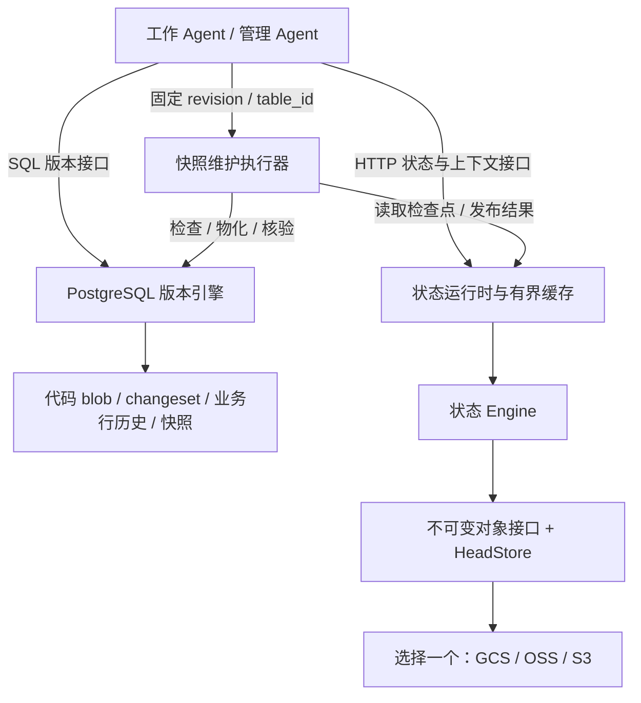

[English](TECHNICAL_BLOG.en.md) | 中文

# 让 Agent 的工作可以提交、分支和接手：AgentDB 的第一阶段实现

2026 年 10 月 16 日 · 项目阶段记录；云服务状态、本机审查与真实 GPT 实验补充于 2026 年 10 月 17 日修订。

> **云服务未经真实验证，云端部署暂缓。** OSS、GCS、S3 均没有真实云端联调结果，ECS 未部署。本文的云存储部分描述代码设计与本地模型，不代表已经在云端运行或验证成功。

一个 Agent 修改了定价代码，同时调整了一批商品价格。另一个 Agent 正在同一份数据上实验新的库存规则。管理 Agent 刚刚为某个历史版本生成快照，还没来得及报告结果，进程就中断了。

这三个场景分别要求系统回答：代码和数据能否一起提交？并行实验能否互不干扰？接手的 Agent 能否判断已经做到了哪一步？

AgentDB 的第一阶段围绕这些问题展开：在 PostgreSQL 中实现代码与业务记录的联合版本管理，并设计用可替换的云对象存储保存管理任务的状态、规则和证据；云端部分尚未真实联调。当前目标负载是单张业务表约 4,000 行、10 个并发 Agent。

版本引擎有现有本机 PostgreSQL 的测试记录；GCS、阿里云 OSS 和 S3 适配器只具备代码与本地测试。用户报告已创建杭州 OSS 桶，但项目未核验其权限、配置和真实读写。当前不安排云服务器采购或部署，本文不将本地结果表述为云存储已验证。

## 两个真实 GPT Agent 带来的三个发现

10 月 17 日，我们让两个真实 GPT/Codex 子 Agent 操作同一个本机 PostgreSQL 测试库。库中有 4,000 行商品，两者从相同版本出发，处理商品 101：价格 Agent 将价格从 10 提高到 11，库存 Agent 将库存从 100 减少到 95；每个提案同时保存对应的 Python 规则和数据修改。这次小实验让接口设计中的问题变得具体。

### 同一次合入，可能遇到两种不同的冲突

价格 Agent 先核对差异并合入主分支。库存 Agent 随后尝试合入旧提案，实际经历了下面的过程：

| 库存 Agent 的操作 | 数据库返回或最终结果 |
|---|---|
| 用共同起点作为预期主分支版本，合入旧提案 | `40001 / stale_head`：主分支已经前进 |
| 读取最新主分支，再尝试合入同一个旧提案 | `P0001 / merge_conflict`：商品 101 存在整行冲突 |
| 从最新主分支建立恢复分支，重新提交库存修改 | 价格保持 11，库存变为 95，合入成功 |

第二次失败解释了为什么不能简单地“更新版本号，再重试”。旧库存提案中的整行状态是价格 10、库存 95，而主分支已经是价格 11、库存 100。当前引擎按整行比较，即使两个 Agent 修改的是不同字段，也会报告冲突。

库存 Agent 在重读后，从最新版本重新表达“库存减少 5”这个意图，核对新差异只改库存，再完成合入。数据库独立核验确认最终价格为 **11**、库存为 **95**，两份代码都保留，其余 **3,999 行**保持原值，固定基线也没有改变。

这个过程给出的设计反馈是：**版本过期与内容冲突需要可区分的结果，客户端需要重读和重新提案的入口。** 当前整行比较增加了不同字段修改时的协调成本；同时，数据库端的拒绝规则保护了已经合入的价格修改。

### Agent 发现工具只能给出哈希，却不能给出代码

库存 Agent 在检查已有提案时指出：`info/diff` 能显示新增文件的路径和哈希，却无法返回代码正文，因此它无法在合入前确认文件里的 `STOCK` 常量是否正确。

底层数据库已有按版本读取文件的能力，实验工具尚未暴露这一能力。根据这条反馈，我们补上 `read-code --revision UUID --path ...`，让 Agent 按固定版本读取指定规则文件。库存 Agent 随后读取并确认 `PRICE = 11.0` 和 `STOCK = 95`，再完成核验。

这暴露的是客户端契约的缺口：**引用能定位证据，Agent 还需要一个按需取回证据的接口。** 只返回“文件已经写入”或内容哈希，不足以支持代码与数据的一致性检查。这个新增入口来自真实使用中的反馈。

### 中断之后，可以从已保存的提案继续

首次尝试因模型账户额度限制中断。当时数据库中已有库存提案和一个尚未写入的价格分支，主分支未改变。继续实验时，协调者提供原任务、基线和提案标识，接手的 GPT 再通过固定版本读取、差异和代码正文确认实际状态，从已有工作继续。

这次接手表明，任务说明与可定位的版本引用能成为恢复的具体入口。原库存提案仍由旧分支保留，修正后的提案另行提交；最终检查没有发现遗留工作事务。这里使用的是 PostgreSQL 中已有的版本记录，没有验证云端管理检查点的恢复。

这是一项有明确任务、有限工具和分阶段协调的两 Agent 实验。协调者安排了合入顺序，并提示区分两类冲突及从新版本重新提案；GPT 负责实际读取、判断、提交和核验。代码只检查语法与常量，未执行。结论限于这次受控流程，长期自主运行和更多模型并发仍待测试。详细过程及独立数据库核验见[本机实验报告](LOCAL_REVIEW_RESULTS.md)与[结构化 GPT 记录](../gpt-agent-experiment.json)。

## 从一次观察到十轮重复实验

为检验行为是否稳定，我们预先登记并执行了 **10 轮**相同任务，每轮重新创建两个 GPT 上下文和一个 4,000 行测试库。接口明确返回模型 **`gpt-6-astra`**、推理强度 **`xhigh`**。这记录了精确的服务模型 ID，底层权重快照没有对外暴露；此前单轮没有型号记录，不能事后补认。

| 指标 | 本次观察 |
|---|---|
| 完成全部三阶段 / 预登记轮次 | 8 / 10 |
| 达成任务 / 预登记轮次 | 8 / 10（80%） |
| 工具调用 | 共 261 次；完成轮次每轮 31–33 次 |
| 已报告用量，含中断轮次的部分用量 | 2,611,119 tokens；缓存和推理子项不重复相加 |
| 曾覆盖另一方已发布内容 / 修改对方分支 | 0 轮 / 0 轮 |

完成的 8 轮中，8 轮依次经历了旧主分支版本和整行内容两类冲突。调用差异主要来自读取与核验：info 每轮 5–7 次，read-code 9–10 次，diff 5–6 次；写入流程则都包含 3 次建分支、3 次提案和 4 次合入请求，其中 2 次合入被冲突检查拒绝。这说明即使结果一致，工具使用成本仍会变化。每次写入后都直接核查数据库，检测器还用“先覆盖、后来恢复”的反例检验过，覆盖结论并非只根据 Agent 自述或最终状态得出。

本组中第 3、4 轮收到服务端 `usageLimitExceeded` 返回；这些轮次没有被替换。它们未完成，不能作为模型不会恢复冲突的证据；中断前未覆盖也不能推断继续执行一定安全。错误原文、每次工具请求和响应、逐 Agent 用量均保存为原始 JSONL，后续可以重新分析，而不必依赖这篇摘要。

这组实验仍然由协调器控制“库存提案→价格合入→库存恢复”的顺序，并明确提示先尝试旧版本、必要时重新提案；不是十个模型同时写入，也不是没有提示的自主恢复。总体成功率包含运行服务失败；二项模型下的 95% Wilson 区间为 49.0%–94.3%，共享账户故障与小样本使它不能直接代表生产可靠性。逐轮结果、部分用量口径和原始证据入口见[重复实验报告](GPT_REPEAT_EXPERIMENT.md)。云服务仍未经真实验证。

## 从 Scion 得到的启发，如何落到数据库上

项目的出发点之一，是 Anthropic 对 Scion 的介绍：把复杂版本操作集中到服务端，让在线客户端按需获取内容，使用不可变对象，并把索引和快照作为可派生的数据。这些原则使我们开始思考，Agent 的数据库接口是否也应该围绕固定版本、并行实验和恢复来组织。[Scion 原文](https://www.anthropic.com/engineering/redesigning-source-control)

在本项目中，这个问题被转换成了可以检验的目标：创建分支时不复制业务表；同一提交能够绑定代码与数据；Agent 重启后不必遍历全部历史；重复请求和并发竞争具有明确结果。

现阶段没有证据表明 PostgreSQL 或 Spanner 无法满足我们的负载。直接重写存储引擎，也无法自动解决分支隔离、上下文恢复和外部操作重试。因此我们先复用 PostgreSQL 的事务与约束，将工作流要求落实为具体的数据结构和接口，再根据测量结果决定是否需要分片或更换底层实现。

这里的“面向 Agent”，主要体现在客户端契约上：固定版本是显式输入，冲突是结构化结果，接手依据是可读取的任务状态。Agent 不需要依靠聊天记忆维持这些约定。

## 两类状态，两个持久化边界

项目管理两类不同的事实。

| 内容 | 实现或设计中的位置 | 主要问题 |
|---|---|---|
| 代码文件、业务记录及其版本关系 | PostgreSQL | 修改是否原子发布，分支是否隔离，合并是否有效 |
| 管理任务检查点、事件、规则版本和证据 | 计划使用所选云对象存储；未经真实验证 | 任务如何接手，命令如何去重，上下文如何保持有界 |
| 最近读取的任务与不可变对象 | 运行时内存 | 减少重复读取；丢失后可以重新加载 |

代码与设计结构如下；图中的云端连接尚未真实验证。对象存储适配器的设计是每次部署只选择一个，不做自动跨云双写。



这张图同时标出了一个重要边界：**PostgreSQL 内部可以提供代码与业务数据的原子提交，PostgreSQL 与云对象存储之间没有共同事务。** 管理任务的恢复必须考虑“数据库已经成功，状态报告尚未发布”的情况。

版本逻辑目前主要由 SQL / PL/pgSQL 实现，管理状态服务使用 Python。`vc` 是 PostgreSQL 中的 schema 名称；分支“指针”是表中保存的提交 ID，并不表示项目另外实现了一个 C++ 指针库。

## 一次 changeset，同时记录代码与数据

假设商品 1 的价格是 100，Agent 想把价格改为 90，并提交对应的定价代码。我们希望这个实验有一个共同的版本 ID，以便比较、合并或读取它产生的完整结果。

版本模型中的主要对象如下：

| 对象 | 职责 |
|---|---|
| `vc.changeset`、`vc.parent` | 提交身份及有序父提交关系 |
| `vc.branch` | 分支名称、当前提交和创建基线 |
| `vc.blob`、`vc.path_change` | 按内容哈希保存文件，以及相对父版本的文件变化 |
| `vc.row_change` | 按逻辑表 ID、主键记录行的 before / after |
| `vc.work_tx`、`vc.pending_*` | 当前事务尚未封口的修改 |
| `vc.snapshot_*` | 指定提交和业务表的派生快照 |

不可变性需要一个明确的成立时刻。如果只禁止更新历史，却允许不断向旧 changeset 插入新的文件或行变化，旧版本依然会改变。

因此写入先进入当前事务的暂存区，再由 `finish_change()` 写入完整历史并移动分支头。它仍处于 SQL 事务内部；其他连接看到新版本，要等到真正的 `COMMIT`。遗漏封口操作时，延迟约束触发器会拒绝提交，已经发生的普通表修改也一起回滚。[版本引擎实现](../sql/001_core.sql)

下面是使用现有 API 的示例。前提是在已安装演示结构的测试库中，main 已有商品 1，且分支名尚未使用；这些语句采用 psql 的变量语法。

```sql
SELECT vc.head('main') AS base_revision \gset
SELECT vc.fork('pricing-experiment', :'base_revision');

BEGIN;
SELECT vc.begin_change(
  'pricing-experiment', :'base_revision',
  'pricing-agent', 'adjust price and pricing code'
);
UPDATE agent.products SET price = 90 WHERE id = 1;
SELECT vc.write_file(
  'src/pricing.py', convert_to('DISCOUNT = 10', 'UTF8')
);
SELECT vc.finish_change() AS proposed_revision \gset
COMMIT;
```

这里的 `agent.products` 是分支视图，写入由 `INSTEAD OF` 触发器转成暂存变化。真正代表 main 的普通表是 `app.products`。在实验分支上修改价格，不会直接改变 main。

同一事务内对一行多次修改，只保留第一次 before 和最后一次 after。插入后立即删除可以抵消，主键变化则表现为旧键删除和新键插入。这样，一个 changeset 描述的是最终有效变化，避免把每次触发器调用都永久保存成独立版本。

分支创建只增加版本指针，不复制业务行或文件内容。不过它仍有索引与事务开销；“不复制整表”不能被解释为延迟永远不随系统负载变化。

### 固定版本读取与合并

分支的基线必须冻结。假如实现成“分支覆盖层加上实时 main”，main 后续产生的修改就会悄悄进入旧分支，实验结果无法复现。

当前读取按提交 ID 解析状态。行状态沿第一父链回放；共同祖先查找则使用全部父边。合并提交可以有两个父提交，但它记录的变化相对第一父提交，不能把两套遍历规则混在一起。

读取加速使用 `(changeset, table_id)` 定位的快照。物化时，快照行和完成标记在同一事务中可见。快照能够重建，创建它仍会写出该表在该版本下的行，因此这里实现的是逻辑覆盖层，不是存储页级的写时复制。

当实验完成，可以比较差异并尝试合入 main：

```sql
SELECT * FROM vc.diff_files(:'base_revision', :'proposed_revision');
SELECT * FROM vc.diff_rows(
  :'base_revision', :'proposed_revision', vc.table_id('app.products')
);

BEGIN;
SELECT vc.merge('main', :'proposed_revision', :'base_revision', 'pricing-agent');
COMMIT;
```

合并检查 base、目标版本和来源版本，目前采用整行、整文件粒度。相同记录被两侧改成不同结果，会报告冲突；尚未实现字段级自动合并。合入 main 时，还要执行普通表 DML 并检查 PostgreSQL 原生约束。文件冲突、唯一键冲突或外键失败，都应使整次合入回滚。

并发控制也有明确范围：不同分支分别锁自己的分支记录，同一个 main 分支头上的发布仍然串行。旧的 `expected_head` 会被拒绝。代码与数据放在同一数据库，保证的是这些数据库对象一起发布；它不会自动把代码部署到外部进程，更不会让邮件、支付等外部动作加入同一个事务。[设计说明](../DESIGN_REVIEW.md)

## Agent 丢失上下文后，从哪里继续

版本管理解决了“数据是什么”，管理任务还需要回答“现在要做什么”。即使 Agent 的服务全天运行，模型调用之间也可能丢失上下文，进程和网络也可能中断。

如果每次恢复都读完整操作日志，读取量和上下文长度就会随着任务寿命增长。将日志换一个存储位置，并不能单独解决这个问题。因此管理状态采用一个小入口指向当前完整检查点的结构：

```text
task head
  ├── state_ref     → 当前完整状态
  ├── event_ref     → 最新事件 → 更早事件 → …
  └── commands_ref  → 已发布命令的去重索引

当前状态
  ├── goal / status / next_action
  ├── uncertainties / facts
  ├── policy_ref
  └── evidence_refs
```

状态对象上限是 **32 KiB**。每次发布都会保存一份完整但有界的检查点，因此读取当前状态只需要 head 和状态两个逻辑对象。事件链保留用于审计，只有显式请求历史时才分页读取。

详细报告和规则文本通过内容哈希引用；单个证据对象当前上限为 1 MiB，超过时需要拆分。大任务也需要拆分，不能通过删掉尚未解决的事实来勉强满足大小限制。

这个设计把三种增长成本分开了：

- 历史存储量继续增长，需要未来的保留与回收策略。
- 普通恢复只读取当前检查点，不随事件条数扫描历史。
- 进入模型的内容另受上下文预算约束，必要时按引用补读。

上下文 API 默认限制为 **8,192 个 UTF-8 字节**。这不是 8,192 tokens；精确 token 预算需要配置具体编码器。目标、下一步、未决事项等必要字段保留，可选事实和证据超预算时返回省略数量与引用。如果必要内容本身已超预算，就明确报错。

运行时使用按条目数和字节数限制的内存缓存。重要操作可以要求 `fresh=true`；通知只让缓存失效，再从权威状态重新读取。冷恢复的“两次逻辑读取”不包含随后按需下载规则和证据的成本，也不等于整个 Agent 接手只会发生两次网络请求。[状态实现](../agent_state/engine.py)、[上下文与缓存实现](../agent_state/runtime.py)

## 发布顺序与幂等：响应丢失之后仍能判断结果

对象存储没有为这里的一组对象提供跨对象事务。发布流程因此先准备不可变内容，最后更新任务入口：

```text
校验请求和新增证据引用
  → 写状态对象
  → 写事件对象
  → 写命令索引的新节点
  → 条件发布 head
```

最后一步是单个任务的发布点。前面写完、head 尚未发布时中断，读者仍从旧入口读取；先写出的对象可能成为孤儿，需要未来的 GC 处理。head 成功发布后，其引用的对象已经存在。

客户端提供 `command_id` 和读取到的 `expected_version`。两个写者都基于版本 7 修改状态，只允许一个把入口推进到版本 8，另一个获得冲突并重新判断意图。

还有一种更难处理的情况：服务端已经发布版本 8，但响应在网络上丢失。调用方重试时，即使任务后来又到了版本 9，也应该能认出当初那条命令已经完成。

所以系统没有只保存“最后一个命令 ID”。它用内容寻址、写时复制的哈希树保存历史命令回执，head 只保存索引根。查询按命令 ID 的哈希路径定位，不逐条扫描事件链；新提交只重写受影响的索引节点。[对象与命令索引实现](../agent_state/objects.py)

重试规则是：相同 ID、相同请求返回原结果；相同 ID、不同请求则拒绝。请求指纹包含 actor、状态、预期版本和事件描述，所以网络结果不明时，应保留整条请求重试。随手把预期版本改大，已经改变了请求含义。

不可变对象并不意味着内存没有修改，或底层没有磁盘写入。它约束的是已发布对象的逻辑内容。这里的 changeset 也是应用层版本记录，不能等同于 PostgreSQL 自身用于持久化与恢复的 WAL。当前项目同样没有实现 Scion 那套压缩格式或存储布局。

## 适配 OSS：同样的发布语义，需要不同的底层操作

为了让部署者可以选择国内云服务，我们将阿里云 OSS 作为国内适配目标，同时保留 GCS 和 S3。适配的关键是验证底层操作能否满足条件发布语义。

| 后端 | 当前适配器的任务入口发布方式 |
|---|---|
| GCS | 按 generation 条件写入；创建使用 generation 为 0 的前置条件 |
| S3 | 创建使用 `If-None-Match: *`，更新使用 `If-Match: ETag` |
| OSS | 向 Appendable 对象的指定位置追加一条固定长度记录 |

GCS 与 S3 的写入条件分别依据其官方接口；自定义 S3 兼容端点仍需要单独验证，不能仅凭兼容名称就认定语义一致。[GCS 请求前置条件](https://docs.cloud.google.com/storage/docs/request-preconditions)、[S3 条件写入](https://docs.aws.amazon.com/AmazonS3/latest/userguide/conditional-writes.html)

OSS 的 `PutObject` 不支持 `If-Match` / `If-None-Match` 这组条件参数，因此不能直接套用同一套覆盖逻辑。[OSS 条件参数限制](https://help.aliyun.com/zh/oss/user-guide/0017-00000245)

我们采用的替代基础是 `AppendObject`：请求中的 `position` 必须与对象当前长度匹配，否则返回位置冲突。下面的固定记录格式和读取流程是本项目建立在该接口上的协议，当前通过的是本地协议模型验证。[OSS AppendObject](https://help.aliyun.com/zh/oss/developer-reference/appendobject)

### 固定 8 KiB 记录，按位置竞争

每个任务使用一个 `head.json.append-v1` 对象。每条记录固定为 8,192 字节，包含格式标识、有效载荷长度、SHA-256 校验、最多 4,096 字节的 head JSON，以及零填充。

假设当前文件长 16,384 字节，两个写者都要求从这个位置追加。第一个成功后，长度变成 24,576；第二个携带旧位置，就会因位置不匹配而失败。这为上层提供了“仅当入口仍是我读到的版本时才发布”的能力。

条件冲突后，适配器不能自动改用最新末尾再追加。那会让本来基于旧状态的修改绕过竞争检查。恢复必须回到 Engine，检查原命令回执或重新判断业务意图。

读取当前入口时，先取得长度，再通过范围请求读取最后一条 8 KiB 记录。若两次请求之间又发生追加，原先选定的记录仍然完整有效，返回它对应的版本即可；后续写入仍由位置条件判断是否过时。实现还检查类型、长度对齐、返回范围和校验值，异常时直接拒绝读取。[OSS 适配器实现](../agent_state/oss.py)

这带来了固定的额外空间成本，也有明确的寿命上限：首版把每个任务的追加文件限制为 **4 GiB，也就是 524,288 次发布**。达到上限会拒绝新发布并保留旧状态，尚无透明轮转；更长的工作流需要显式建立后继任务。这个上限只计算入口记录，状态、事件和索引对象还会额外占用空间。

桶配置同样属于协议前提。不可变普通对象采用禁止覆盖的创建方式，而 OSS 在开启或暂停版本控制时不会按该请求头禁止同名覆盖，因此当前适配器要求版本控制从未开启，并拒绝不支持的保留策略配置。运行期间也不能删除或替换活跃入口、复用任务 ID。[OSS PutObject](https://help.aliyun.com/zh/oss/developer-reference/putobject)、[本项目存储协议](STORAGE_BACKENDS.md)

为隔离这些差异，Engine 依赖独立的 `HeadStore`，只关心读取和条件发布。存储返回的 generation、ETag 或追加位置都作为不透明标记使用；缓存的新旧排序依据应用层 `version`，不尝试比较两个 ETag 谁“更大”。

## Superuser Agent 如何维护系统并交接

管理 Agent 可以持有 PostgreSQL superuser 能力，负责维护数据库结构、版本规则和派生数据。AGENTS.md、CLAUDE.md 描述操作约定，数据库账户和云身份提供真实权限；规则文本本身不会授予权限。

高权限让 Agent 能够改变系统，也使“维护动作如何被接手”成为必要设计。我们把流程定义为：先发布目标和核验方法，检查真实系统，执行操作，再核验并发布结果。采用的规则文本可以存为证据，通过 `policy_ref` 固定版本。

当前已经实现的维护执行器是固定版本快照物化。它以 `revision` 和逻辑 `table_id` 为目标，调用 `vc.materialize()`，并通过 `vc.snapshot_status()` 检查是否存在完成记录。SQL 层使用事务锁协调同一目标的物化，完成记录与快照行在同一事务提交。常规维护新增受限角色 `agentdb_manager`，不替代改变系统规则的管理员；旧安装先应用 `db.py install-manager` 迁移。[快照维护执行器](../agent_state/maintenance.py)

本机实验以真实 WSL PostgreSQL 和内存 OSS 模型检查了以下故障窗口，未连接真实 OSS：

1. Agent A 发布维护意图。
2. PostgreSQL 完成快照物化并提交。
3. 在发布任务完成状态之前，注入中断。
4. 重建运行时，由 Agent B 读取任务检查点并核对 PostgreSQL。
5. Agent B 发现快照已经存在，发布核验结果，无需再次物化。

接手结果中的 `verified=true` 只表示本机 PostgreSQL 快照已核验，`applied=false` 表示本次接手没有再次执行物化；二者都不表示云存储验证成功。[本地接手实验记录](../cloud-postgres-oss-protocol.json)

这套机制的适用条件很具体：执行器必须能够幂等执行，或者可靠探测既有结果。任务状态的条件发布不会自动保证任意外部动作只执行一次。新的 DDL、部署或服务重启执行器，都需要各自定义核验、排他与恢复方法；当前项目尚未提供一个通用的自主运维执行器。

## 本地实验与未经验证的云端边界

已有结果来自本机 PostgreSQL、内存服务模型、SDK 测试替身和回环 HTTP。没有真实云存储的测试结果。

| 本地实验 | 已记录结果 | 解释范围 |
|---|---|---|
| 真实 PostgreSQL | 18 项集成测试通过 | 使用既有 Ubuntu WSL PostgreSQL 16.15 |
| 4,000 行、10 并发连接 | 独立分支 10 个成功；同一旧 main head 竞争时 1 成功、9 个陈旧版本错误 | 合成并发连接模拟 Agent 写入，不包含模型推理 |
| 数据库接手 | 中断后成功核验，未重复物化 | 真实 PostgreSQL 加内存 OSS 协议模型 |

数据库结果见 [本机验证记录](../VALIDATION.md) 与 [原始测试报告](../test-results-local.json)。状态适配器的本地环境及范围见 [本地测试说明](STORAGE_BACKENDS_VALIDATION.md)，其中不包含云端成功记录。

历史增长实验也只运行于内存 OSS 模型；其读取计数不属于真实 OSS 流量或性能测量。这里不列作云存储验证结果，原始本地数据保留在 [模型实验记录](../oss-protocol-benchmark.json)。真实一致性、持久性、延迟、吞吐、容量和费用均未经验证。

上表早期 PostgreSQL 并发实验只用于当前功能结论，其内部计时不包含最终 COMMIT，不能拿来宣传持久化提交延迟；本项目没有与 Spanner 或其他版本数据库做同条件性能对照。

10 月 17 日的补充审查修复了旧维护者在另一执行者完成后吞掉发布冲突的问题，并增加意图已记录、数据库尚未执行时的接手测试。两个中断窗口、旧执行者冲突和受限管理权限均已在真实本机 PostgreSQL 检查；状态仍为内存模型。完整本地状态套件为 53 项，原有 PostgreSQL 断言为 18 项。

同日新增“十个分支最终全部合入”的实验：4,000 行中修改 100 行，保留十个代码文件，端到端约 14.9 秒，包含客户端开销、45 次陈旧 head 重试和最终 COMMIT。这是十个脚本写入者的一次争用实验；14.9 秒是这一组数据库操作的计时，不是前述两个 GPT Agent 的协作耗时。[本机审查与 GPT 实验记录](LOCAL_REVIEW_RESULTS.md)

## 接下来需要解决的工程问题

当前实现让分支、联合提交和有界恢复具有了可运行的行为模型，但距离长期运行还需要补齐几个环节。

云端联调和常驻部署当前暂缓，`smoke_cloud.py` 与部署草案仅保留供未来使用。当前继续本地开发和模拟测试，不把购买服务器作为继续项目的前提。

本地可以继续优化版本查询。当前一些读取仍依赖祖先回放，行合并会反复解析目标状态，文件合并会枚举已记录路径；不能因为 changeset 只保存变化，就宣称所有操作成本都只取决于变化量。点查、谓词下推、批量状态解析与长历史负载，应成为下一组测量对象。

长期保存则需要明确的生命周期协议：哪些版本必须保留，哪些快照可以重建，如何识别孤儿对象，如何保证 GC 不删除并发发布中的内容，以及 OSS 入口如何安全轮转。省下恢复扫描，不等于省下历史存储。

最后，DDL 版本化、字段级合并、生产 HTTP 部署、全局任务调度和更多维护执行器都尚未完成。当前版本引擎仍是单节点 PostgreSQL，main 发布使用分支锁。是否需要更深层的分布式设计，应由这些具体路径的负载与失败模式来决定。

AgentDB 下一阶段要继续验证的是：在历史更长、任务更多、故障更复杂的情况下，Agent 仍能以明确的版本提交工作，以有限的上下文理解当前状态，并通过可核验的结果把任务交给下一个执行者。
